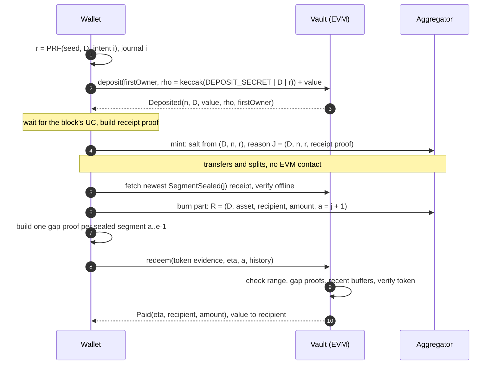
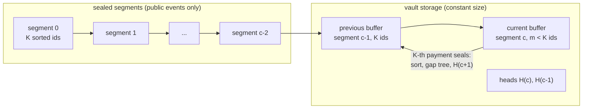
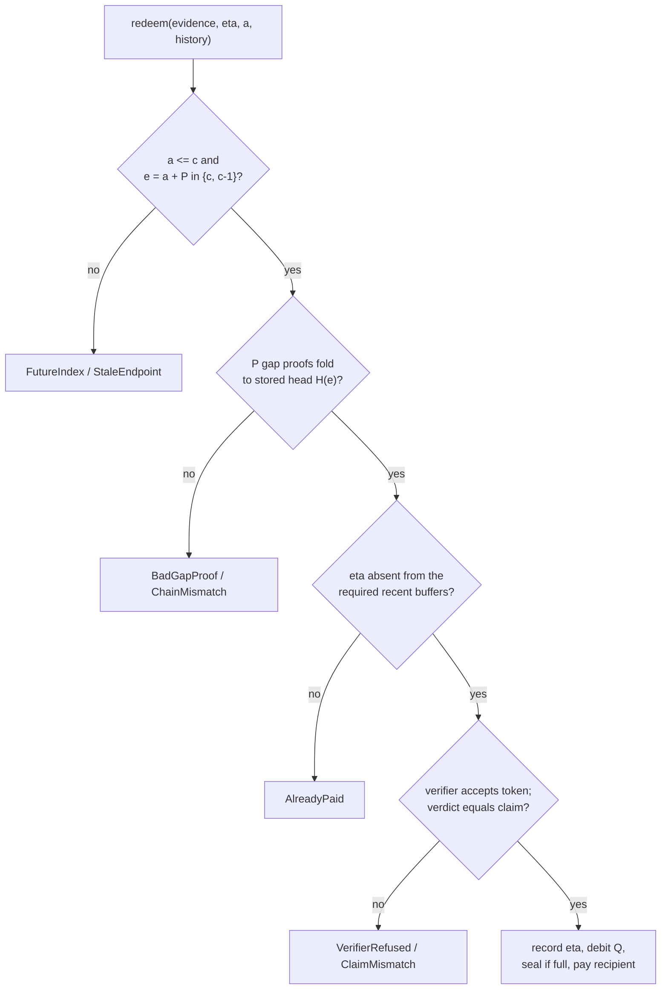

# Native bridge v2: indexed burns and bucketed redemption segments

Status: **frozen specification, development profile, not activated** (NB2-01, #1097; tracking #1096). It replaces the
protocol 6/7 bridge (lock records, per-lock accounting, `0x0104`/`0x0105` kernels) for all new work. There is no
migration from, compatibility with or dual decoding of protocol 6/7; NB2-10 (#1106) removes it.

Everything below is fixed byte for byte. The values the gas bake-off (NB2-02, #1098) was to choose are now fixed by its
measurements (ristik/unicity-pos-contracts#80, `bench/nb2/README.md` and `RESULTS.md`): `K = 64`, `B = 16`, position-tag
recent buffers, the circular-gap commitment and `gasReserve` 500,000 (Section 15). The remaining **PARAM** marks are
deployment values (`L_max`, `Qmax`, `returnReserveSegments`), pinned by NB2-09 (#1105) and the owner. The companion byte contract for wallets is `protocol/interop.md` in native-bridge-plugins; it
carries the same bytes. If the two ever differ, this document is the reference and the difference is a bug.

Section 1 is the plain-language picture. Sections 3 to 13 are the rules. Section 14 lists every rejection rule by name.

## 1. How it works, in plain words

A user locks native UCT in one EVM contract, the **vault**, and receives the same amount as an ordinary Unicity token.
The token moves and splits off-chain like any other token. To get UCT back on the EVM, the holder burns a token part
and sends one EVM transaction that proves two things: the burn is genuine, and it has not been paid before.

**Deposit.** The wallet picks a secret `r` and sends `deposit(firstOwner, rho)` with the value, where `rho` is a hash
of `r`. The vault counts the deposit (number `n`), adds the value to its liability total and emits one `Deposited`
event. It stores nothing per deposit. The token ID is derived from `n` and `r`, so a chain observer who sees the event
cannot compute the token ID and cannot occupy it before the owner mints.

**Mint.** Once the deposit block is certified, the wallet makes an ordinary Unicity mint. Its reason carries `r` and a
receipt proof of the `Deposited` event. Anyone holding the token can later check, offline, that it is backed by a real
deposit into this vault.

**Circulation.** Transfers and splits are the SDK's, unchanged. Nothing touches the EVM.

**Burn.** The holder burns a whole part. The burn signs the EVM recipient, the amount and one number `a`: the lowest
redemption segment in which the vault may pay it. The wallet reads `a` from a verified `SegmentSealed` receipt, so it
can never be in the future.

**Redeem.** The vault keeps the identifiers of recent payments in two small buffers. Every K payments (K = 64) the
current buffer is **sealed**: sorted, hashed into a Merkle tree of the gaps between consecutive identifiers, chained to
the previous segments and published in one `SegmentSealed` event. A redemption proves "not paid in sealed segments
`a` to now" with one short gap proof per segment, built by the wallet from public events. The vault checks the two
recent buffers itself, verifies the token, pays the signed recipient and records the identifier.

The vault's state never grows: one accounting word, two tag words, two chain heads and two buffers of K identifiers.







Checks before the token verifier are only a cheap filter. Nothing is granted until the verifier's verdict equals the
claimed identifier and index (Section 10).

## 2. Scope and known limits

First release: native UCT only, one asset per vault. Whole split parts return independently in any order; a partial
return needs an ordinary split first. Fixed signed recipient. Direct wallet submissions only.

Not in this release: ERC20, joins, destination redirection, continuation for oversized claims (NB2-12, #1108),
helper/indexer services, new ureth state, hooks or consensus rules, bridge-specific precompiles (`0x0105` is not
used), time-anchored burns.

Limits that stay visible:

- **Mint admission (#1039 / ISS-01).** The hidden token ID stops at-leisure blocking from chain observation. An
  observer of the mint request or a hostile aggregator can still race it. A compatible end-to-end mint-admission
  remedy remains a prerequisite for real-value activation, as in the source design; this specification does not solve
  it. Removing that prerequisite requires an explicit owner decision accepting the irreversible-deposit risk, recorded
  alongside the activation decisions in Section 15.
- **Capacity.** A claim that waits through too much traffic may not fit one transaction (Section 12.5). There is no
  recovery path in this release.
- **Pooled custody.** There is no per-deposit backstop. A verifier bug that accepts a forged lineage can pay out other
  depositors' backing. NB2-03 (#1099) and NB2-05 (#1101) carry the independent-implementation requirement.
- **Recipient.** An immutable recipient that always reverts strands its burn. Wallets default to a controlled EOA.

## 3. Notation and primitives

- `C(x, ...)` is canonical CBOR of an array. `b(x)` is a byte string, `tag(t, x)` a tagged item. Domain literals are
  ASCII byte strings.
- The NB2-defined arrays and fields admit only the CBOR item types specified for those fields, with definite lengths,
  shortest heads, exact arity and complete consumption. These restrictions do not replace the native UC/UTB codecs:
  certificates and trust-base objects, whether inline or carried inside byte strings, use their pinned native
  canonical encoding (bft-go-base `v1.1.1-0.20261109140746-dbf94198f25e`, pinned in the profile), including signature
  maps and signer text keys. Decode and validate those objects with that encoding and its structural bounds; reject
  duplicate map keys. Do not apply the NB2 array-only item whitelist recursively inside a native certificate. SDK
  transaction/predicate encodings remain those of the pinned SDK revisions.
- **Nesting depth** (`cborDepth` 16). A *decoding unit* is a top-level input (Γ, `evidence`) or the content of a byte
  string that the profile decodes as CBOR (`J` and a split justification inside a mint's `b(J)`, `R` inside a
  transfer's data, `data`). Within one unit the top-level item is at depth 0 and each array, map or tag opening adds 1
  for its children; a container whose children would sit at depth above 16 is `InputTooLarge`. A byte-string-wrapped
  child is scanned afresh from depth 0, so lineage depth never accumulates. The scan of `evidence` includes the inline
  aggregator UCs (their native codec bounds apply in addition). UC size bounds (profile `limits`): the EVM receipt UC
  `evmUcBytes` 16,384 (Section 6.2); each aggregator UC `aggregatorUcBytes` 24,576 (`b1ref.MaxUCBytes`).
- `H_U` is SHA-256 (the Unicity hash). `H_E` is EVM `keccak256`. They are distinct functions and never substituted.
- `||` is byte concatenation. `u8`, `u16`, `u64` are fixed-width big-endian integers. `u256(x)` is the 32-byte
  big-endian word. Identifiers compare as unsigned 256-bit big-endian integers.
- **Amount** in CBOR is a minimal positive unsigned big-endian byte string of 1 to 32 bytes (no leading zero). In the EVM
  ABI it is `uint256`. Decoding: an empty string is `IntRange`, more than 32 bytes is `Length`, a leading zero byte is
  `NonCanonical`.
- **EVM domain tags** are bytes32 constants `TAG(name) = H_E(ASCII(name))`:

| Name | Value |
|---|---|
| `DEPOSIT_SECRET` = `TAG("UNICITY_NB2_DEPOSIT_SECRET")` | `0xdfa87a7a4c6db3c7c307e4f2c3cc2d4a07e33d349f542b47f8e0bba49f62e645` |
| `ARCHIVE_GENESIS` = `TAG("UNICITY_NB2_ARCHIVE_GENESIS")` | `0x45076af3d8858f1d7a9bb6e037bb5ca4270d0b4fa90f9397eb7adb905590a339` |
| `ARCHIVE_STEP` = `TAG("UNICITY_NB2_ARCHIVE_STEP")` | `0xc68efdc45f5c9a20bf6abfda6493e8e295d8e31495fd1e744cd4c35f74785dfa` |

- The Merkle tags are the single bytes `0x00` (leaf) and `0x01` (node).
- **CBOR tags.** New: `39051` NativeReceiptBacking (mint reason `J`), `39052` NativeSegmentReturn (return data `R`).
  Unchanged SDK tags: `39032` predicate, `39041` mint, `39045` transfer, `39031` certification data, `39040` token,
  `39033` inclusion proof, `39050` value, `39044` split justification, `39046` split manifest. The protocol 6/7 tags
  `39048` and `39049` are rejected wherever a v2 structure is expected.
- `NATIVE_BRIDGE_PROTO_VERSION = 9`. Every structure below that carries a version carries `1`. (Protocol 8 was the
  first draft of this profile; its arity-7 `DepositProof` with a PDR is rejected, never accepted alongside.)

## 4. Configuration and domain

### 4.1 The configuration tuple Γ

```
Γ = C(b("UNICITY_NB2_CFG"), 1,
      network,                  // α: uint, 1..65535 (SDK NetworkId)
      b(rootGenesis32),         // g_root: EntryID of the authenticated genesis trust-base entry
      b(executionGenesis32),    // g_evm
      chainId,                  // uint64, nonzero
      evmPartition,             // β_evm: uint32, nonzero
      b(evmShard),              // canonical native shard ID of the EVM shard, 1..33 bytes
      aggregatorPartition,      // β_agg: uint32, nonzero, != evmPartition
      b(vault20),               // a_V
      b(asset32),               // a_UCT, Section 4.2
      b(ty32), b(aid32),        // token type and coin ID, Section 4.2
      b(semanticProfileHash32), // SHA-256 of the exact bytes of plug-ins protocol/profile.json (below)
      b(verifier20),            // token verifier address
      b(verifierCodeHash32),    // EXTCODEHASH of the verifier
      K,                        // uint, 64 in production (test builds: 4 or 8)
      B,                        // uint, 16 in production (test builds: 2 or 4)
      b(Qmax))                  // Amount, 1 <= Qmax <= 2^144 - 1 (Section 9.1)
D = H_U(Γ)
```

Arity 19. Every listed width is exact. `(K, B)` must lie in the admitted set, and the vault and verifier reject
anything else: production builds admit only `(K, B) = (64, 16)`. A test build admits the separate test set `K` in
{4, 8} × `B` in {2, 4} instead (the NB2-03 vectors use it), never both. `K` and `B` are constructor immutables of the
vault (measured by #1098 at 170–350 gas per payment, about 7,000 per seal and 1.9 KB of code against compile-time
constants); the `m < K` storage rule of Section 11.1 holds for every admitted `K`. `D` is the deployment domain: a reset or a new vault has a new `D`, even on a reused chain
ID.

`semanticProfileHash32` is SHA-256 of the exact published UTF-8 bytes of `protocol/profile.json`, including whitespace
and its final newline. Do not parse and reserialize or canonicalize JSON before hashing. The profile binds its
normative artifacts through their exact-file SHA-256 digests. Regenerate those digests and the profile digest after any
normative edit.

Fixed by #1098 (measured): `K = 64`, `B = 16` (`h = 6`, 4-bit tags, one tag word per buffer).

The vault constructor receives the exact bytes of Γ, rejects them unless `vault20 == address(this)`,
`chainId == block.chainid`, `verifier20.codehash == verifierCodeHash32`, `asset32`, `ty32` and `aid32` each equal their
Section 4.2 derivation, and `K`, `B`, `Qmax` are admitted, and then fixes `D` as an immutable. 
A refusal is `BadConfig(field)`. Validation is staged, and the stage order is frozen. First the array: not an array of 19, trailing bytes, any scan error or more than 1024 bytes is 19. Then the fields in index order 0..18, reporting the first one that fails its own width, range and admitted-set rule. aggregatorPartition == evmPartition is field 8. (K, B) not admitted is 16 when K itself is not in the build's K set, and 17 otherwise. Only a Γ that decodes completely is checked against the deployment, in this order: asset32 (10), ty32 (11), aid32 (12), vault20 == address(this) (9), chainId == block.chainid (5), verifierCodeHash32 == EXTCODEHASH(verifier20) (15). Γ's bytes stay readable through `config()`. The verifier is stateless and configuration
free: it receives Γ on every call (Section 11), which avoids a cycle between its code hash and Γ.

### 4.2 Asset identity

```
Dstr = networkDecimal ":" rootGenesisHex ":" executionGenesisHex ":" chainIdDecimal
ty   = H_U(UTF8("unicity-bridge:unicity-native-nb2:" + Dstr))
aid  = H_U(UTF8("unicity-bridge-coin:unicity-native-nb2:" + Dstr))
a_UCT = H_U(UTF8("unicity-nb2-asset:native-uct"))
```

Decimals have no leading zeros, hex is lowercase without `0x`. `ty` and `aid` exclude the vault: a replacement v2 vault
on the same chain issues the same coin, but every token stays bound to its own vault through `D` in its mint reason.
The `-nb2` family string keeps v2 tokens apart from protocol 6/7 tokens.

### 4.3 Deployment manifest pins (not in D)

The authenticated deployment manifest (schema written by NB2-09, #1105) pins, outside `D`:

- `vaultRuntimeCodeHash`: the vault's runtime code hash. It is not in Γ, because the vault's immutables contain `D`.
  Wallets check it once at installation against certified EVM state.
- `maxEncodedTxBytes` (`L_max`): the effective encoded-transaction limit of the deployment's pool and RPC path.
- `userGasLimit`: the block gas available to user transactions (`max_gas - system_gas` of the production profile).
- `gasReserve` and `returnReserveSegments`: Section 12.
- `deploymentBlock`: the vault's creation block, where segment scanning starts.
- `stateReadOnly`: `true` only on test deployments, where a plain `state()` read may replace the receipt rule of 12.2.

> **PARAM** `L_max`: {131072, 524288}, default **524288 (512 KiB)**, pending the owner decision of Section 15 and the
> pool/RPC/peer measurement of NB2-09 (#1105).

The vault is immutable: no owner, upgrade, pause, administrative payout, `receive` or `fallback`. It emits no event
except the three of Section 13.2.

## 5. Deposit

### 5.1 Wallet secret

Before submitting value the wallet derives and journals

```
r   = HMAC-SHA256(key = k_w, msg = C(b("UNICITY_NB2_DEPOSIT_INTENT"), b(D), i))
rho = H_E(DEPOSIT_SECRET || D || r)             // 96 bytes hashed
```

`k_w` is a 32-byte wallet bridge key derived deterministically from the wallet seed under a wallet-versioned
derivation scheme whose recovery metadata is backed up with the seed. `i` is a uint64 intent counter and is never
reused. Before signing a value-bearing deposit transaction, durably journal `(D, i)` and back up a recoverable
high-water mark covering that intent, or back up the intent's `r` directly. Recovery requires that backup in addition
to the seed. With a recovered high-water mark, scan every allocated intent through that mark and match `rho` against
certified `Deposited` events; an optional look-ahead does not replace the mark. Seed-only bounded recovery is not
guaranteed in the presence of arbitrary abandoned intents. Never derive `r` from public or low-entropy values. Reusing
`r` is prohibited wallet behavior; distinct deposit nonces still derive distinct root IDs.

### 5.2 `deposit`

```solidity
function deposit(bytes calldata firstOwner, bytes32 rho) external payable;
```

Under the shared reentrancy guard, in this order:

1. `msg.value > 0`, else `ZeroValue()`.
2. `firstOwner` is exactly the 42-byte tagged signature predicate
   `d9 9878 83 01 41 01 58 21 || key33` (`tag(39032, [1, b(0x01), b(key33)])`) with `key33[0] in {0x02, 0x03}`, else
   `BadFirstOwner()`. The vault does not check that the key is on the curve; an invalid key strands its own deposit,
   and the verifier rejects it.
3. `msg.value <= Qmax - Q`, else `LiabilityCap(Q, msg.value, Qmax)`.
4. `n < 2^56 - 1`, else `DepositCounterExhausted()`.
5. `n <- n + 1`, `Q <- Q + msg.value` in the accounting word (Section 9.1), with masked field updates.
6. Emit `Deposited(n, D, msg.value, rho, firstOwner)`.

Deposit numbers start at 1. There is no refund, cancellation or per-deposit storage. Unsolicited value (for example
from `SELFDESTRUCT`) is surplus and never increases `Q`; `balance(vault) >= Q` holds under correct execution.

### 5.3 Salt and token ID

```
salt_n = H_U(C(b("UNICITY_NB2_DEPOSIT_SALT"), b(D), n, b(r)))
id_n   = H_U(C(b(salt_n), network))             // the SDK token ID rule, unchanged
```

The vault never computes `salt_n` or `id_n`.

## 6. Mint reason and deposit proof

### 6.1 Encoding

```
J = tag(39051, [1, b(D), n, b(r), DepositProof])
DepositProof = [1, b(evmUC), b(headerRLP), txIndex, logIndex, [b(receiptNodeRLP), ...]]
```

`J` has body arity 5. `DepositProof` has arity 6 and is inline, not byte-string wrapped; any other arity or version,
including the arity-7 protocol 8 draft that carried a PDR, is rejected (`Shape`, `Version`). `n`, `txIndex` and
`logIndex` are uints (`n` in `[1, 2^56-1]`, indices below `2^32`). `evmUC` is the complete canonical native
UnicityCertificate encoding. The index, header and receipt bounds and rules below are unchanged. The receipt is not carried separately: it is the
value of the final node of the receipt-trie path. The same `DepositProof` container, with the `SegmentSealed` event,
is the **seal receipt proof** of Section 12.2.

The root mint is the SDK mint `M = tag(39041, [2, network, P0, b(salt_n), b(ty), b(J), b(data), e])` with
`P0 = firstOwner`, `data = tag(39050, [1, [[b(aid), b(v)]], null])` and `e` null or a uint64 deadline (SDK rule).

### 6.2 Verification (wallet, recipient and on-chain verifier alike)

Decode strictly and bound before any cryptography (bounds in the profile JSON: `justificationBytes` 65536,
`evmUcBytes` 16384 for `evmUC`, `headerBytes` 2048, `receiptNodes` 65, `receiptBranchNodeBytes` 1024,
`receiptLeafNodeBytes` 49152). `justificationBytes` bounds the encoded receipt-backed root reason `J` (tag 39051,
including its `DepositProof`) only. It does not apply to a split justification (`SplitJ`, tag 39044), which embeds its
whole parent token and grows with the lineage: a `SplitJ` is bounded only by the enclosing evidence, `L_max` and gas,
so there is no split-depth limit. Then, in order:

1. `J.D == D` (`MintDomain`).
2. Verify `evmUC` under the authenticated historical root authority of its own seal epoch (Section 11.3), for exactly
   Γ.`evmPartition` and Γ.`evmShard` (`DepositUC`). No independently expected shard-configuration hash is supplied.
   The UC's own 32-byte ShardConfHash MUST remain part of the authenticated shard-tree leaf, together with its
   InputRecord and TRHash; verify the complete shard/unicity paths and seal. All certificate structural, network,
   epoch-interval and quorum checks remain mandatory. No PDR is supplied and no PDR-to-InputRecord epoch comparison
   is performed. (An implementation that calls a UC verifier with a nil expected hash must still hash the UC's actual
   ShardConfHash into the leaf; it never substitutes nil or zero for it.) Every EVM-certificate failure is `DepositUC`:
   encoding, network, epoch interval, structure, partition/shard, folds and quorum, for deposit and seal receipts
   alike. The one exception is `NoEntryForEpoch`, which keeps its retryable name in wallets (on chain it is `DepositUC`
too; Section 11.3).
3. `H_E(headerRLP) == UC.InputRecord.blockHash` and `header.stateRoot == UC.InputRecord.hash` (`DepositHeader`).
   This is the certificate of the block that **executed** the deposit, not of its parent. `headerRLP` is the Cancun
   execution header of the pinned Unicity execution profile (the go-ethereum v1.14.11 `types.Header` Cancun shape): the canonical RLP list of exactly 20 fields, in order,
   `parentHash, ommersHash, beneficiary, stateRoot, transactionsRoot, receiptsRoot, logsBloom (256 bytes), difficulty,
   number, gasLimit, gasUsed, timestamp, extraData, mixHash, nonce (8 bytes), baseFeePerGas, withdrawalsRoot,
   blobGasUsed, excessBlobGas, parentBeaconBlockRoot`, minimal integers, decode then re-encode identical. Require
   `ommersHash` the empty-list hash, `difficulty = 0`, `0 < baseFeePerGas < 2^64`, `withdrawalsRoot` the empty-trie
   root, `blobGasUsed = excessBlobGas = 0`, `number < 2^63` and `extraData` at most 32 bytes. Any other field count,
   including a Prague `requestsHash`, is `DepositHeader`.
4. Verify the path under `header.receiptsRoot` with key `RLP(txIndex)`: canonical nodes, hash or embedded references,
   complete key consumption, no unused or duplicate node (`ReceiptPath`). The leaf value is a legacy receipt
   `RLP([status, cumulativeGas, bloom, logs])` or `type || RLP(...)` with `type in {0x01, 0x02, 0x03}`; anything else
   is `ReceiptType`. `status == 1` (`ReceiptStatus`).
5. `logs[logIndex]` exists (`LogIndex`), its address equals `vault20` (`LogEmitter`), and its topics are exactly
   `[topic0(Deposited), u256(n)]` (`LogTopics`).
6. Its data is exactly the 224-byte ABI encoding of `(bytes32 D, uint256 v, bytes32 rho, bytes firstOwner)` with
   offset `0x80`, length 42 and zero padding (`LogData`); `D` equals `J.D` and `v > 0`.
7. `rho == H_E(DEPOSIT_SECRET || D || r)` (`SecretOpening`).
8. The mint's salt is `salt_n` (`MintSalt`), its type `ty` (`MintType`), its first owner exactly `firstOwner`
   (`MintOwner`), its data the value envelope of exactly `aid` and `v` (`MintData`).

The vault address and the immutable deployment are authenticated by `D` (which binds `vault20` and `chainId`) and by
the manifest's runtime code hash; Cancun forbids redeploying different code at an address, so no per-receipt code
proof is carried. An RPC log listing or a transaction inclusion proof alone is never deposit evidence.

**Deployment binding and chain continuity.** Acceptance relies on the authenticated deployment binding Γ's root
genesis, partition/shard and execution genesis to one continuous EVM history, whose authorized assignment changes
preserve its execution identity and state. A configuration rotation does not change the authoritative vault address
or invalidate earlier certified receipts. A chain reset or replacement is a new authenticated deployment/domain, not a
continuation of this vault. D alone does not prove execution ancestry. Wallets MUST authenticate this deployment
binding and its pinned vault code as required by Sections 4.3 and 12.1; the on-chain verifier uses the corresponding
chain-authenticated historical authority.

## 7. Circulation and split lineage

Token, predicate, transfer, certification and inclusion-proof wire formats are the SDK's, unchanged (`protocol/interop.md`
"SDK wire" lists them byte for byte, with the strict unlock-recovery, time and refresh rules of protocol 7, which carry
over unchanged, except the NB2 unlock restriction of Section 14.4: recovery IDs 0 and 1 only). Owners are signature
predicates; the first burn is terminal. For reading this document:

```
P     = tag(39032, [1, b(encode_uint(type)), b(params)])    // type 1: signature, params key33; type 2: burn, params H_U(R)
M     = tag(39041, [2, network, P0, b(salt32), b(ty32), b(J), b(data), e])
T     = tag(39045, [2, Pnext, b(mask32), dataOrNull, e])
CD    = tag(39031, [2, Psource, b(sourceHash32), b(txHash32), e, b(unlock65)])
Token = tag(39040, [2, [M, proof0], [[T1, proof1], ...]])
proof = tag(39033, [1, CD, t, b(bitmap32 || siblings32...), UC])
txHash = H_U(exact tagged M or T bytes)        sid = H_U(C(Psource, b(sourceHash32)))
```

Each transaction is certified by the aggregator through its inclusion proof, whose UC is judged under Section 11.3.
Intermediate transfers carry null data; a token ends either in its split-manifest burn or, for the returned part, in
the return burn of Section 8.

Splits use the SDK's burn-and-mint `TokenSplit` with the protocol 6 lineage formats, unchanged: manifest
`tag(39046, [b(root32)])`, allocation tree leaves `H_U(0x10 || key32 || data32 || u256(v))`, nodes
`H_U(0x11 || u8(depth) || hL || u256(sL) || hR || u256(sR))`, child commitment
`H_U(C(b("UNICITY_SPLIT_OUTPUT"), b(parentId), network, b(P), b(salt), b(childId), b(ty), b(exactChildMintData)))` and
`SplitJ = tag(39044, [ParentToken, [Proof]])`. The verifier walks from the returned part to the root while the mint
reason is `SplitJ`; the root's reason must be `J` (Section 6). One state-ID set covers the whole lineage. Every
non-returned token in the walk ends in its manifest burn; each edge's allocation proof verifies against the parent's
manifest root and the sum equals the parent's amount. Rule names are the protocol 6 ones (Section 14.4).

What changes from protocol 6: there is no per-lock accounting. Each part is redeemed by its own redemption ID
(Section 8.2); conservation follows from the lineage relation (Section 16).

## 8. Return burn and redemption identifier

### 8.1 Return data

```
R = tag(39052, [1, b(D), b(asset32), b(recipient20), b(v), a])
```

Body arity 6. `a` is a uint in `[0, 2^48 - 1]`, the minimum segment index at which the burn may be paid. The final
transfer of the returned part has predicate `Burn(H_U(R))` (type 2, params the raw 32-byte hash) and data exactly `R`.
`v` is the returned part's own amount. `recipient20` is nonzero and not `vault20`. There is no archive hash, fee,
deadline or redirection field.

### 8.2 Redemption identifier

```
btid = H_U(C(b("UNICITY_NB2_BURN"), b(sidBurn), b(txHashBurn)))
eta  = H_U(C(b("UNICITY_NB2_REDEMPTION"), b(D), b(btid)))
```

`sidBurn` is the SDK state ID of the burn transfer's source state and `txHashBurn` the SDK hash of the exact tagged
burn transfer. Refreshed inclusion paths, other certificates, proof encodings and submitters never change `eta`; `a`
is inside `txHashBurn` and so is immutable too. `bucket(eta) = eta >> (256 - log2 B)`.

## 9. Vault state

### 9.1 Logical state and the accounting word

```
Σ = (A, T_0, T_1, H_c, H_{c-1}, S_0, S_1)
A = n << 200 | c << 152 | m << 144 | Q          // n: 56 bits, c: 48, m: 8, Q: 144
```

`n` is the last deposit number, `c` the current segment index, `m` the current buffer's population (`0 <= m < K`
always holds in storage; Section 11.1 step 7) and
`Q` the outstanding liability. Field updates are masked and range-checked; a carry or borrow never reaches a
neighbouring field. `c` never exceeds `2^48 - 1` (`SegmentCounterExhausted()`), `n` never exceeds `2^56 - 1`.

`p = c mod 2` names the current buffer, `1 - p` the previous one. `H_c` is the current archive head, `H_{c-1}` the
previous one (invalid at `c = 0`). At construction `A = 0`, `H_0` is set (Section 10.3) and nothing else is written.

### 9.2 Recent buffers: position tags

`S_p[i]` for `0 <= i < K` is the `i`-th identifier paid into buffer `p` in arrival order. The tag words `T_p` hold one
`log2 B`-bit tag per position: `tag_p(i) = bucket(S_p[i])`. With `t = floor(256 / log2 B)` tags per word, tag `i` is in
word `floor(i / t)` at bit offset `log2 B * (i mod t)` (least significant first).

At `K = 64, B = 16` (and for every test-set pair) each buffer has exactly one tag word.

The live entries of buffer `p` are positions `i < pop(p)`, with `pop(current) = m` and `pop(previous) = K` when
`c > 0`. Cells and tags at or beyond the population are stale and ignored; nothing is ever cleared. Identifier storage
is bounded by `2K` slots (128 at `K = 64`), plus `2 * words(K, B)` tag words.

The recent-buffer layout is position tags, fixed by #1098 (measured against v2's sparse per-bucket arrays). Storage
slot numbering is not part of the wire contract: wallets use views, events and receipts only. The externally admitted
bounds are `n <= 2^56-1`, `c <= 2^48-1` and `Qmax <= 2^144-1`; wider physical fields would not authorize wider values,
and a later change to external bounds requires a separately versioned profile/specification amendment.

## 10. Segments and the gap commitment

The segment commitment is the sorted circular-gap tree, fixed by #1098 (measured against compressed-radix and
adjacent-leaf multiproof candidates). Sections 10.1–10.2, history sizing and the capacity formula instantiate it. A
later change of commitment requires a separately versioned profile that replaces all of those definitions, with
cross-implementation vectors; no decoder may guess an alternative history format from calldata.

### 10.1 Sorted circular-gap tree

Sealed segment `j` contains exactly the `K` identifiers paid while `c = j`, sorted strictly increasing
`z_0 < z_1 < ... < z_{K-1}`. With `h = log2 K`:

```
leaf_i = H_E(0x00 || z_i || z_{(i+1) mod K})                 // 65 bytes hashed
node   = H_E(0x01 || left || right)                          // 65 bytes hashed, ordered children
M_j    = root of the complete binary tree over leaf_0 .. leaf_{K-1}
```

No padding, no sorted-pair hashing. The last leaf is the exterior gap that wraps around the numeric domain. Zero and
`2^256 - 1` are ordinary identifiers, not sentinels.

### 10.2 Gap proof

```
proof = u8(i) || l (32) || u (32) || s_0 (32) || ... || s_{h-1} (32)       // exactly 65 + 32h bytes
```

257 bytes at `K = 64`, 289 at `K = 128`. A proof is valid for `eta` against root `M` when `i < K` and

- `i < K - 1`: `l < u` and `l < eta < u`;
- `i = K - 1`: `l > u` and (`eta > l` or `eta < u`);

and folding `x = H_E(0x00 || l || u)` with `s_k` for `k = 0 .. h-1` gives `M`, where step `k` computes
`H_E(0x01 || x || s_k)` if bit `k` of `i` is 0 and `H_E(0x01 || s_k || x)` if it is 1. No root is sent; it is derived.

### 10.3 Archive chain

```
H_0     = H_E(ARCHIVE_GENESIS || D || u16(K))                              // 66 bytes hashed
H_{j+1} = H_E(ARCHIVE_STEP || D || u64(j) || H_j || M_j)                   // 136 bytes hashed
```

### 10.4 Sealing

When a payment is the `K`-th of the current segment (`m + 1 == K` before it is recorded), in the same transaction and
before the payout call:

1. Read `S_p[0 .. K-1]`, distribute by tag, sort within each bucket with a bounded worst-case sort (one bucket can
   hold all `K`), and concatenate buckets in increasing order. #1098 measured a hybrid (insertion-sorted 8-element
   chunks, then bottom-up merges with `MCOPY`) at about half the cost of heapsort; any sort with the same output is
   conforming. Assert strict increase and that every identifier lies in its tagged bucket.
2. Compute `M_c` and `H_{c+1}`; emit `SegmentSealed(c, H_c, H_{c+1}, z_0 || ... || z_{K-1})`.
3. Set `H_{c-1} <- H_c`, `H_c <- H_{c+1}`, `c <- c + 1`, `m <- 0`. The full buffer becomes the previous one; the old
   previous buffer becomes current without clearing.

There is no empty, early, timed or public seal. Segment indices count payment groups, not blocks or time.

## 11. Redemption

### 11.1 `redeem`

```solidity
function redeem(bytes calldata evidence, bytes32 claimedEta, uint64 claimedStart, bytes calldata history) external;
```

- `evidence = C(1, Token)`: the complete returned part as one SDK token (`tag(39040, ...)`, inline), carrying every
  transaction with its inclusion proof and, through its mint reason, its lineage and deposit proof. Proof
  consolidation and refresh may replace inclusion paths and UCs under the SDK's rules; transaction bytes and reference
  times never change.
- `history` is empty when `P = 0`, and otherwise `startHead (32) || proof_0 || ... || proof_{P-1}` with each proof
  `65 + 32h` bytes, so `P = (len - 32) / (65 + 32h)`.

Order of checks, with the error each one raises:

1. Reentrancy guard (`Reentrancy()`). Length of `history` is 0 or `32 + P(65 + 32h)` with `P >= 1`, else
   `BadHistoryLength(len)`.
2. `a = claimedStart`, `e = a + P` (checked). `a <= c`, else `FutureIndex(a, c)`. `e == c`, or `c > 0` and
   `e == c - 1`, else `StaleEndpoint(e, c)`.
3. If `P > 0`: fold from `startHead` through `j = a .. e-1`, `x <- H_E(ARCHIVE_STEP || D || u64(j) || x || M_j)` with
   `M_j` derived from proof `j - a` for `claimedEta` (a malformed or non-gap proof is `BadGapProof(j - a)`), and
   require `x` equal to the stored `H_e` (`ChainMismatch()`).
4. Scan the current buffer, and also the previous buffer when `e == c - 1`: every live position whose tag equals
   `bucket(claimedEta)` must hold a different identifier, else `AlreadyPaid(claimedEta)`.
5. `STATICCALL` the verifier (Section 11.2) with `(config(), evidence)`. A revert is `VerifierRefused(revertData)`
   when the revert data is at most `MAX_VERIFIER_REVERT` = 1024 bytes. Longer revert data, and return data other than
   exactly 192 canonical bytes, is `VerifierBadReturn()`. The vault reads `returndatasize()` before it copies anything
   and never copies oversized data.
6. Verdict checks: `domain == D` (`DomainMismatch()`), `asset == a_UCT` (`AssetMismatch()`),
   `(eta, minSegment) == (claimedEta, claimedStart)` (`ClaimMismatch()`), `recipient` nonzero and not the vault
   (`BadRecipient()`), `amount > 0` (`ZeroAmount()`), `amount <= Q` (`LiabilityUnderflow(Q, amount)`).
7. Effects: `S_p[m] <- eta`, `tag_p(m) <- bucket(eta)`, `Q <- Q - amount`; emit `Paid(eta, recipient, amount)`. If
   `m + 1 == K`, seal (Section 10.4), which stores `m = 0`; otherwise store `m + 1`. The value `m == K` is never
   stored: `m < K` always holds in storage.
8. Pay exactly `amount` to `recipient` with a plain value call forwarding the remaining gas; failure is
   `PayoutFailed()` and reverts everything, including the seal and the logs. A recipient that re-enters `redeem` or
   `deposit` from its receive hook gets the inner error `Reentrancy()`; if the hook does not propagate that revert,
   the outer payout succeeds.

Steps 1 to 4 grant nothing. A forged `claimedEta` that passes them fails step 6. Clients reserve full verification gas
for every first claim; the cheap rejections are a convenience, not a bound for inputs built to evade them.

### 11.2 Verifier interface

```solidity
interface INativeBridgeVerifierV2 {
    function verifyReturn(bytes calldata gamma, bytes calldata evidence)
        external view
        returns (bytes32 domain, bytes32 eta, uint64 minSegment, bytes32 asset, address recipient, uint256 amount);
}
```

Selector `0xdf447dca`. The verifier is stateless, has no owner or configuration of its own, and reverts on every
refusal with a custom error named by Section 14 (`<RuleName>()`, selector `H_E("<RuleName>()")[0..4]`). On acceptance
it returns the authenticated `(D, eta, a, asset, recipient, v)` of the returned part. Its check order is frozen, so a multi-fault input classifies the same way in every implementation:

1. Γ (`ConfigShape`), then `D`.
2. `evidence = C(1, Token)`: the outer pair is `EvidenceShape`; the token and every nested item fail with the 14.1
   rules.
3. The walk from the returned part to the root: a mint reason tagged 39044 is a split reason (`SplitJustif`,
   `SplitProofCount`, `SplitProofShape` and the inline parent token's wire rules); 39051 ends the walk; anything else
   is `MintReason`.
4. The root's `J` (Section 6.2, in its order).
5. Root first, every token of the walk: mint fields (`MintShape`, `MintType`, `MintData`), `NoTransfers`, then the mint
   and each transfer in order (`CDMismatch`, `DeadlineMismatch`, the unlock rules, `DeadlineExpired`, `RepeatedSID`,
   then its inclusion proof: the UC in the per-UC order of Section 11.3 for partition `aggregatorPartition`, then
   `InclusionProof`, `ReferenceTime`), each intermediate transfer's recipient (`BurnNotFinal`) and data
   (`TransferData`); a parent's terminal split burn (`SplitBurn`, `SplitManifest`); after each child, its allocation
   edge (`SplitProof`, `SplitSum`).
6. The part's terminal burn: `NotBurn`, `ReturnData`, `ReturnIndex`, `ReturnDomain`, `ReturnAsset`, `ReturnAmount`,
   `ReturnRecipient`, `BurnReason`. `R.asset` is compared against the `a_UCT` constant.
7. `btid` and `eta` (Section 8.2); return.

**Verifier batching (on chain).** The verifier puts UC claims into the fewest `0x0100` `CERT_BATCH_V2` calls. It flushes
the pending claims before raising any later rule and before returning, so a certificate failure is always reported
before a rule that follows it in the order above. If a call returns false, the verifier re-checks the claims one at a
time, in order, and reports the earliest failure.

The vault and the verifier are separate deliverables behind this interface (NB2-04, #1100, and NB2-05, #1101). The
internal division of the verifier into Solidity and existing generic primitives (`0x0100` certificate batch, `0x0102`
membership) is NB2-05's decision gate and changes no byte above.

### 11.3 Historical authority

Every UC (the deposit's EVM UC and every aggregator UC) is judged under the Unicity Trust Base entry of its own seal
epoch, by the upstream seal rule of `protocol/trust-base.md` in native-bridge-plugins (its NB2 revision, hashed by the
profile): weights and threshold `floor(2W/3) + 1` of that entry, root round inside the epoch's interval, an unknown
signer or a signature that fails the weighting rule contributes zero. Legacy bridge pre-scans MUST NOT add a rejection
solely for a signature's length or recovery byte; native certificate structural constraints still apply. `Γ.rootGenesis32`
is the EntryID of the authenticated genesis trust-base entry and `Γ.network` the installed history's network. Wallets hold the history and retry `NoEntryForEpoch`. On chain the verifier reads the same
history from the chain's permanent seal registry through the generic certificate primitive, at any certificate age.
A later rotation never invalidates an earlier certificate. The deployment-binding and chain-continuity assumption of
Section 6.2 applies to every EVM UC judged here: deposit receipts and seal receipts alike.

**Per-UC order (frozen).** `UnsupportedCertificateEncoding`, `SealNetwork`, `CertStructure`, `SealRoot`, then the
authority verdict: the epoch entry, the root round inside its interval, and quorum. On chain the `0x0100`
`CERT_BATCH_V2` primitive returns one bool covering the epoch entry, the round interval, the network and quorum, and
the seal registry exposes no epoch table to Solidity, so the authority verdict has one on-chain name: `QuorumNotMet`
for an aggregator UC and `DepositUC` for the EVM UC. Wallets, which hold the bundle, refine it into `NoEntryForEpoch`
(retryable: fetch newer entries and retry), `SealEpoch` and `QuorumNotMet`; `SealEpoch` and `NoEntryForEpoch` are
wallet-side names only.

## 12. Wallet rules that affect safety

### 12.1 Before depositing

Journal `(D, i)` and back up `k_w` together with the intent journal's high-water mark covering `i` (or the intent's
`r`) before submitting (Section 5.1); local journaling alone is not a backup. Check the deployment (Γ, `D`, manifest pins, runtime code hash) and
the first owner. Submit `deposit`. Keep the deposit transaction hash; build `J` after the block is certified.

### 12.2 Choosing the burn index (review amendment R1)

Before burning, the wallet obtains the newest `SegmentSealed(j)` receipt it can, as a `DepositProof` container whose
log is `SegmentSealed` (topics `[topic0(SegmentSealed), u256(j)]`, data per Section 13.2) from `vault20`, and verifies
it offline exactly as Section 6.2 steps 2 to 5, under the same UC rule (no PDR, the UC's own ShardConfHash in the
authenticated leaf, exact Γ partition and shard) and the same deployment-binding assumption. It signs `a = j + 1` and keeps `headAfter = H_{j+1}` as the starting
head for a later redemption. If it holds no seal receipt, it signs `a = 0` (starting head `H_0`, computed).

- The index can never be in the future: `c` never decreases and the receipt proves `c >= j + 1`.
- A provider that hides newer seals only makes the wallet anchor lower and pay more gap proofs.
- A plain `state()` read replaces the receipt only when the manifest's `stateReadOnly` is true (test deployments).

### 12.3 Building the history at redemption

Fetch one `SegmentSealed` log per segment `a .. c-1` from any RPC or archive. For each, check the length (`32K`
bytes), strict order, recompute `M_j` and check `H_{j+1} = H_E(ARCHIVE_STEP || D || u64(j) || headBefore || M_j)` and
`headAfter` equal to it. If `eta` is in a segment, it has been paid (reconcile with `Paid`). Otherwise build its gap
proof. Choose `e = c` (or `e = c - 1` when the chain moves while preparing); one rollover between preparation and
inclusion is tolerated, two make the endpoint stale and the wallet rebuilds the history without changing the burn.

### 12.4 Gas-limit reserve

Every redemption's gas limit is the expected cost plus `gasReserve`, because intervening payments can make any
transaction the sealing one or the worst scan. `gasReserve` is the measured envelope: the most expensive redeem call
minus the cheapest, including first-generation segments (0 and 1), rounded up. It is not the sum of the two worst
cases, which cannot both fall on one call at full cost.

**`gasReserve` = 500,000** (fixed by #1098, `K = 64, B = 16`, optimizer runs 200). Measured: worst sealing surcharge
229,830; worst recent scan (`2K - 2` cold identifier reads) 282,548; worst single call 487,339; envelope 433,765 in
steady state and 453,641 including segments 0 and 1. The earlier 620,000 planning value is withdrawn.

### 12.5 Size preflight

With `L_T` the encoded evidence, `L_O` all other transaction framing (including the 32-byte start head when `P > 0`)
and `P_max = floor((L_max - L_T - L_O) / (65 + 32h))`:

- Before certifying the return burn, choose `a` by Section 12.2 and obtain a current endpoint estimate `c_obs` with
  `c_obs >= a`. Set `P_now = c_obs - a`. Refuse with `CapacityPreflight` unless the complete prospective return,
  including its burn transaction and certification evidence, is admitted by every parser/component bound and fits both
  the encoded-transaction limit and `userGasLimit` with `P_now + returnReserveSegments` historical proofs
  (`returnReserveSegments` is a manifest value, **default 64 segments**, 4,096 payments at `K = 64`). Include
  `gasReserve` and all ABI padding, transaction framing and calldata gas. If any required evidence-size or gas bound
  cannot be established, refuse to burn. The displayed `P_max` formula is a planning approximation; admission uses the
  complete encoded transaction or a conservative upper bound. An old seal receipt consumes capacity before the burn.
  If it leaves insufficient reserve, obtain a newer authenticated receipt or refuse. Freshness and future inclusion
  remain availability assumptions: even this check does not guarantee redemption against an indefinitely stale view
  or arbitrary subsequent traffic. `L_T` before the burn is a conservative upper bound: the held evidence plus the burn transfer with its exact `R`, its CD, and an inclusion proof at the decoder bounds (an RSMT path of up to 256 siblings and an aggregator UC up to `aggregatorUcBytes` = 24,576 bytes, `b1ref.MaxUCBytes`).
- At redemption, refuse to submit (`CapacityExceeded`) if `P > P_max` or the gas exceeds `userGasLimit`. In this
  release that burn cannot be redeemed until limits change; it is not recoverable by the wallet.

### 12.6 Burn, submission and retry

Verify the token's full provenance before burning. Construct, persist and certify the terminal burn; durably keep the
exact certified result before reporting success. After a timeout or an ambiguous submission, look for `Paid(eta)`
before retrying; refresh stale history; never alter the certified burn or its index.

When receiving a token intended for return, verify its whole lineage against the NB2 unlock restriction (Section
14.4) and refuse or flag it if any unlock uses recovery ID 2 or 3. Otherwise a previous owner could hand the recipient
a token that can never be returned.

### 12.7 Wallet RPC contract (NB2-06, #1102)

A wallet builds every piece of evidence from the ordinary execution RPC behind the deployment's public gateway (one URL, JSON-RPC 2.0 POST, one request per call: no batches). There is no bridge-specific service. Nothing read here is trusted. Each item is verified offline (Sections 6.2, 12.2, 12.3), and a provider that withholds data can only delay the wallet.

| Need | Method(s) | Notes |
|---|---|---|
| Certificate of block `N` | `eth_getBlockByNumber(N+1, false)`, then `unicity_getSealCompanionV1(hash(N+1))` | Success is exactly `{"status":"found","companion":{...}}` (ureth `SealCompanionLookup`, serde `tag = "status"`, camelCase; the other statuses are `"unavailable"` with `horizon` and `"unknown"`, below). `companion.witnesses[0]` is `evmUC`, the canonical native UC that certifies block `N` (`IR.blockHash = hash(N)`, `IR.hash = stateRoot(N)`). `witnesses[1]` is its technical record, which the wallet does not use. Block `N+1` must name `hash(N)` as its parent. The UC is served once the child block exists, about one round after `N`. Witness 0 of block N's own companion is the certificate of N-1, the one that authorized building N, and is never deposit evidence for N. If witness 0 of N+1's companion does not name `hash(N)` and `stateRoot(N)`, the wallet refuses (`DepositHeader` would reject it anyway) and does not substitute another certificate. |
| Header of block `N` | `eth_getBlockByHash(hash(N), false)` | The wallet re-encodes the header fields as `headerRLP` and requires `H_E(headerRLP) = hash(N)`. |
| Receipt-trie path | `eth_getTransactionReceipt(tx)` for `txIndex` and the receipt-local `logIndex`; `eth_getBlockReceipts(hash(N))` | The wallet rebuilds the receipt trie, requires its root to equal `header.receiptsRoot`, and takes the root-to-leaf path for key `RLP(txIndex)`. `logIndex` is the log's position in its own receipt, not the block-level `logIndex` of the RPC log object. |
| `SegmentSealed` logs (newest seal, 12.2; history, 12.3) | `eth_getLogs({address: vault20, topics: [[topic0(SegmentSealed)], ...], fromBlock, toBlock})` | Paged as described below. The newest seal pages backwards from `eth_blockNumber`, and the history pages forwards from the manifest's `deploymentBlock`. `topics[1]` may list wanted segment indices as `u256(j)` values. |
| `Paid(eta)` for reconciliation (12.6) | `eth_getLogs({address: vault20, topics: [topic0(Paid), eta], ...})` | `eta` is the first indexed topic. A redemption after the burn can only appear after the burn's certification, so the wallet pages forwards from the block where it first submitted. |
| Vault views | `eth_call` of `domain()`, `config()`, `state()` | Used for preflight and status only. `state()` replaces a seal receipt only under `stateReadOnly` (12.2). |
| Simulation and submission | `eth_call`, `eth_estimateGas`, `eth_sendRawTransaction` | These are the only methods with large bodies (see Limits). |
| Retention horizon | `unicity_sealCompanionHorizonV1` | Returns `null` (nothing pruned) or the lowest block number whose companion is still served. |
| Trust-base history (11.3) | The SDK trust-base path (`GET /api/v1/trustbases` on the same host) | Nothing here is specific to the bridge. |

**Limits at the public gateway** (`deploy/testnet/gateway.py`, `public_routes.py`):

- Request bodies are at most 16 KiB for every method above except `eth_call`, `eth_estimateGas` and `eth_sendRawTransaction`. Those take up to 4.5 MiB, which holds a redeem transaction of `L_max = 512 KiB` hex-encoded with its JSON framing, and the gateway reads at most two such bodies at once (`503 busy`: retry). If NB2-09 pins a larger `L_max`, it MUST keep that bound at `2 L_max + 64 KiB` or more.
- `eth_getLogs` MUST name exactly one `address`, and either a `blockHash` or explicit numeric `fromBlock` and `toBlock` (no tags) spanning at most **10,000 blocks** (`toBlock - fromBlock + 1`). Any other filter is refused with HTTP 400 and an error naming the window. The wallet pages in consecutive windows `[lo, lo + 9999]`. A window that the node answers with its result-count error (`query exceeds max results`, at most 20,000 logs per response) is split in half and retried.
- Every evidence read takes exactly its parameters, and anything else is refused with HTTP 400 naming the accepted shape: `eth_getBlockByHash` `[hash, false]` (full transactions are never served), `eth_getBlockReceipts` `[hash]` or `[hex number]`, `unicity_getSealCompanionV1` `[hash]`, and `unicity_sealCompanionHorizonV1` `[]`. A hash is `0x` plus 64 hex digits. An `eth_getLogs` filter has at most 4 topic positions, each null, a 32-byte hash, or a list of at most 64 hashes.
- Rate limits are 5 requests/s per client at nginx (burst 10), plus the gateway's own 10/s per client and 100/s in total. `eth_getLogs` and `eth_getBlockReceipts` also share a tighter 2/s per client and 20/s in total (HTTP 429: back off). A deposit proof takes 5 requests, one of them heavy; a seal receipt takes the same 5 plus one `eth_getLogs` per window searched.
- The gateway relays at most **8 MiB** of one answer. Above that it answers HTTP 413, and the wallet asks for less: it splits an `eth_getLogs` window in half. An `eth_getBlockReceipts` answer over the cap (a block near its gas limit filled with logs) is not served by this gateway, so the wallet uses another provider for that block.
- `eth_sendRawTransaction` goes to every validator. An HTTP 503 ("broadcast may be partial") is ambiguous, because the transaction may still be included. The wallet looks for the receipt of the locally computed transaction hash, and for `Paid(eta)` (12.6), before it resubmits.

**Retention.** Nodes behind the public gateway MUST run as proof sources. That is ureth's default, and only `--unicity.no-proof-source` turns it off. A proof source refuses to start with receipt, receipt-log-filter or body pruning, or with `--unicity.companion-retention-depth`. As a result, companions, receipts and logs are served for the life of the deployment, and `unicity_sealCompanionHorizonV1` answers `null`. Deposit evidence is therefore fetchable at any time after the deposit's child block exists. Segment logs are served for every segment since `deploymentBlock`, which covers any return delay, including more than `returnReserveSegments`. `eth_getProof` is not used, so ureth's `--rpc.eth-proof-window` (64 blocks) does not limit any wallet step. A wallet still builds `J` as soon as the child block exists and keeps it with the token (12.1), so that later minting never depends on a provider.

**What a wallet sees when evidence is missing.**

| Answer | Meaning | Wallet action |
|---|---|---|
| `eth_getBlockByNumber(N+1)` is `null` | The child block does not exist yet | Retry after a round |
| `unicity_getSealCompanionV1` `{"status":"unknown"}` | The node does not hold the hash on its canonical chain (reorganised, not yet imported, or another chain) | Re-resolve `N+1` and retry; do not treat this as a verdict |
| `unicity_getSealCompanionV1` `{"status":"unavailable","horizon":H}` | The node pruned the companion of a block below `H` | `EvidencePruned`: use another provider or an archive; not retryable at this node |
| `eth_getBlockByHash` or `eth_getTransactionReceipt` is `null`, or `eth_getBlockReceipts` is `null` or does not hash to `receiptsRoot` | The node does not hold the block or receipts, or served inconsistent data | `EvidencePruned` or provider fault: use another provider |
| `eth_getLogs` refused with HTTP 400 naming the window | The filter is outside the gateway limits | Fix the filter and page |
| HTTP 413 naming the 8 MiB cap | The answer is too large for this gateway | Ask for less (a narrower window), or use another provider for that block |
| A companion whose `witnesses` is not exactly `[certificate, technical record]` | Provider fault | Use another provider |

`EvidencePruned` joins the wallet refusals of Section 14.6. Like every other refusal, it never changes a burn or an index.

**The lock-proof service is retired.** No step above uses `dnb-tool lockproof-serve`, `eth_getProof` or a validator's certificate archive. NB2-10 (#1106) removes the service from the package:
- `scripts/dnb-tool` `lockproof-serve` with its locator and shard-configuration set (`serve.go`, `locator.go`, `shardconf.go`);
- the `lockproof` service of `deploy/testnet/bridge/overlay.py`;
- the `/lockproof/` route and its rate-limit zone in `public_routes.py`;
- `lockProofUrl` in the tester configuration.

`--rpc.eth-proof-window` stays, because the shard node's parent witness still reads `eth_getProof`.

## 13. Vault ABI

### 13.1 Functions

| Function | Selector |
|---|---|
| `deposit(bytes firstOwner, bytes32 rho) payable` | `0x3489c151` |
| `redeem(bytes evidence, bytes32 claimedEta, uint64 claimedStart, bytes history)` | `0x91de2955` |
| `domain() view returns (bytes32)` | `0xc2fb26a6` |
| `config() view returns (bytes)` (exact Γ) | `0x79502c55` |
| `state() view returns (uint64 deposits, uint64 segment, uint16 population, uint256 outstanding, bytes32 head, bytes32 previousHead)` | `0xc19d93fb` |

`previousHead` is zero at `c = 0`. The constructor is `constructor(bytes gamma)` (Section 4.1).

### 13.2 Events

| Event | topic0 |
|---|---|
| `Deposited(uint64 indexed nonce, bytes32 domain, uint256 amount, bytes32 rho, bytes firstOwner)` | `0x853a9d825910065273b44cf4f0ad33d2525f875d3da0a53f967ae40b7508d2b8` |
| `Paid(bytes32 indexed eta, address indexed recipient, uint256 amount)` | `0x606160394df2742a67735645b7e783304d61d2dbc5b550e8c6acfaf27b6291d7` |
| `SegmentSealed(uint64 indexed segment, bytes32 headBefore, bytes32 headAfter, bytes ids)` | `0x06e724201a1c72937156cbdb3b9522d26b3818ee33ace10cd7cda65bb9cae916` |

Data layouts (standard ABI, exact lengths): `Deposited` 224 bytes (`domain`, `amount`, `rho`, offset `0x80`, length 42,
42 bytes padded to 64); `Paid` 32 bytes (`amount`); `SegmentSealed` `128 + 32K` bytes (`headBefore`, `headAfter`,
offset `0x60`, length `32K`, the sorted identifiers). Logs of failed transactions never count.

### 13.3 Custom errors

| Error | Selector | Raised by |
|---|---|---|
| `ZeroValue()` | `0x7c946ed7` | deposit 1 |
| `BadFirstOwner()` | `0xceb54b37` | deposit 2 |
| `LiabilityCap(uint256 outstanding, uint256 amount, uint256 cap)` | `0x5586a2e8` | deposit 3 |
| `DepositCounterExhausted()` | `0xb6ef324c` | deposit 4 |
| `Reentrancy()` | `0xab143c06` | deposit, redeem |
| `BadHistoryLength(uint256 length)` | `0x37c8cb02` | redeem 1 |
| `FutureIndex(uint64 start, uint64 current)` | `0x39a15193` | redeem 2 |
| `StaleEndpoint(uint64 endpoint, uint64 current)` | `0x683c7c78` | redeem 2 |
| `BadGapProof(uint256 position)` | `0xe7169745` | redeem 3 |
| `ChainMismatch()` | `0xa6226dc5` | redeem 3 |
| `AlreadyPaid(bytes32 eta)` | `0xf4b76a0e` | redeem 4 |
| `VerifierRefused(bytes reason)` | `0x3aa84d02` | redeem 5 |
| `VerifierBadReturn()` | `0xf659e897` | redeem 5 (also: verifier revert data over 1024 bytes) |
| `DomainMismatch()` | `0xce548c1e` | redeem 6 |
| `AssetMismatch()` | `0x83c1010a` | redeem 6 |
| `ClaimMismatch()` | `0x827768e8` | redeem 6 |
| `BadRecipient()` | `0x67a2cc26` | redeem 6 |
| `ZeroAmount()` | `0x1f2a2005` | redeem 6 |
| `LiabilityUnderflow(uint256 outstanding, uint256 amount)` | `0xf9c1fdc7` | redeem 6 |
| `SegmentCounterExhausted()` | `0x011469c0` | redeem 7 (seal) |
| `PayoutFailed()` | `0x3b1ab104` | redeem 8 |
| `BadConfig(uint256 field)` | `0x0dad7c22` | constructor (first failing Γ field 0..18; 19 for array-level failures) |

A wallet classifies a failed simulation by selector: `AlreadyPaid` means reconcile; `StaleEndpoint` means rebuild the
history; `FutureIndex` means wait (it cannot arise from Section 12.2); `BadGapProof`/`ChainMismatch` means a wrong
proof or start head, repairable without a new burn; `VerifierRefused` carries the verifier's rule. `VerifierBadReturn`
means the verifier refused with revert data over 1024 bytes (or returned malformed data), so its rule was not relayed:
the wallet calls `verifyReturn` directly (an `eth_call` to the verifier) or runs its own verifier to read the rule,
rather than retrying the redemption unchanged.

## 14. Rejection rules

Every rule has one name. NB2-03 (#1099) uses `Err<Name>` as the Go sentinel; the on-chain verifier reverts with
`<Name>()`; the vault's names and selectors are those of Section 13.3. Each rule gets one isolated negative vector.

### 14.1 Encoding (all structures)

| Name | Rule |
|---|---|
| `Truncated`, `Trailing` | input ends early, or bytes remain after the item |
| `NonCanonical` | non-shortest head, indefinite length, or a forbidden CBOR item |
| `Shape` | wrong arity, item type or literal domain string |
| `Tag` | unexpected tag, including protocol 6/7 tags 39048/39049 |
| `Version` | a version field other than 1 (SDK structures: their own versions) |
| `Length` | a fixed-width field of the wrong length |
| `IntRange` | an integer outside its range (network, chain, partition, `n`, `a`, indices, `K`, `B`, `Qmax`) |
| `InputTooLarge` | a component over its profile bound |
| `ConfigShape` | Γ fails any of the above or a Section 4.1 constraint |
| `EvidenceShape` | `evidence` is not exactly `C(1, Token)` |

### 14.2 Deposit evidence (Section 6.2)

`MintDomain`, `DepositUC`, `DepositHeader`, `ReceiptPath`, `ReceiptType`, `ReceiptStatus`, `LogIndex`,
`LogEmitter`, `LogTopics`, `LogData`, `SecretOpening`, `MintSalt`, `MintType`, `MintOwner`, `MintData`, and
`MintReason` (the root mint's reason is not `tag(39051, ...)`).

### 14.3 Return (Sections 8 and 11.2)

| Name | Rule |
|---|---|
| `NotBurn` | the part's final transfer does not lock a burn predicate |
| `BurnNotFinal` | a burn predicate before the final transfer |
| `BurnReason` | burn params are not `H_U(R)` |
| `ReturnData` | the final transfer's data is not exactly a `tag(39052, ...)` `R` |
| `ReturnDomain` | `R.D != D` |
| `ReturnAsset` | `R.asset != a_UCT` |
| `ReturnAmount` | `R.v` is not the part's own amount |
| `ReturnRecipient` | recipient zero or the vault |
| `ReturnIndex` | `a` outside `[0, 2^48 - 1]` |

### 14.4 Token and lineage (unchanged from protocol 7)

`Predicate`, `MintShape`, `TransferData`, `CDMismatch`, `UnlockLength`, `UnlockScalars`, `UnlockRecovery`,
`UnlockKey`, `RepeatedSID`, `NoTransfers`, `DeadlineMismatch`, `DeadlineExpired`, `InclusionProof`,
`ReferenceTime`, `SealNetwork`, `SealEpoch`, `NoEntryForEpoch` (retryable), `CertStructure`, `SealRoot`,
`QuorumNotMet`, `UnsupportedCertificateEncoding`, `SplitJustif`, `SplitProofCount`, `SplitProofShape`,
`SplitManifest`, `SplitBurn`, `SplitProof`, `SplitSum`.

`Unlock` and `MinterKey` are dropped: under the frozen unlock order (recovery with the supplied ID, then key equality)
a recovered signature always verifies, and no input reaches either. The scalar-level checks (0, 1, n-1, n, 2^256-1)
keep their names (`UnlockScalars`, `UnlockRecovery`).

**NB2 unlock restriction (versioned, protocol 9 profile artifact 5).** An NB2-eligible token's unlock signatures
must all use recovery ID 0 or 1. Recovery IDs 2 and 3 are refused with `UnlockRecovery` in every implementation: wallets,
provenance and token admission in the plug-ins, the Go reference and the Solidity verifier. This deliberately narrows
the pinned SDK's unlock relation (which admits IDs 0..3) for bridge eligibility only; it is not unchanged SDK
semantics and not an error-name mapping. A token whose lineage contains an ID 2 or 3 unlock remains a valid native
token but cannot be returned through this bridge.

**Wallet and on-chain names.** `SealEpoch` and `NoEntryForEpoch` are wallet-side only. On chain a failed authority
verdict is `QuorumNotMet` for an aggregator UC and `DepositUC` for the EVM UC (Section 11.3).

### 14.5 Redemption (vault)

`BadHistoryLength`, `FutureIndex`, `StaleEndpoint`, `BadGapProof`, `ChainMismatch`, `AlreadyPaid`, `VerifierRefused`,
`VerifierBadReturn`, `DomainMismatch`, `AssetMismatch`, `ClaimMismatch`, `BadRecipient`, `ZeroAmount`,
`LiabilityUnderflow`, `SegmentCounterExhausted`, `PayoutFailed`, `Reentrancy`. Deposit: `ZeroValue`,
`BadFirstOwner`, `LiabilityCap`, `DepositCounterExhausted`. Construction: `BadConfig`.

### 14.6 Wallet refusals (no on-chain counterpart)

`SealReceipt` (a seal receipt fails Section 6.2 steps 2 to 5 for `SegmentSealed`; preserve the inner rule, including
retryable `NoEntryForEpoch` when the wallet lacks the seal epoch after the earlier per-UC checks pass. Every other
EVM-certificate failure has inner rule `DepositUC`. On `SealReceipt` wrapping `NoEntryForEpoch`, extend the
authenticated trust-base history and retry; do not classify the receipt as invalid solely because that entry is
unavailable), `SegmentLog` (a `SegmentSealed` log has the wrong length,
order or chain link), `CapacityPreflight`, `CapacityExceeded`, `ImplausibleIndex` (on a `stateReadOnly` deployment, a
`state()` read whose `c` lies outside `[verified, verified + maxJump]`, `verified` the wallet's last verified index and
`maxJump` 64 by default; a `state()` read on a deployment without `stateReadOnly` is not evidence at all and is
refused without a rule name), `EvidencePruned` (the node no longer serves a
companion, block or receipts the evidence needs; Section 12.7).

### 14.7 Required vectors (NB2-03, #1099)

The vector file is `protocol/vectors/nb2/nb2-vectors.json` in native-bridge-plugins, with its digest in
`protocol/vectors/nb2/nb2-vectors.json.sha256`. Besides one isolated negative vector per rule above, it MUST contain, for deposit receipts and,
identically, for `SegmentSealed` seal receipts:

- valid receipts certified before and after an authorized validator rotation of the EVM shard (different
  ShardConfHash and IR epoch), both accepted, each judged under its own seal epoch's historical authority, never
  the latest committee;
- an altered ShardConfHash without a new valid seal (`DepositUC`);
- a UC of the wrong partition, the wrong shard, or another root deployment (`DepositUC`);
- InputRecord tampering (`DepositUC`) and header tampering (`DepositHeader`);
- the old arity-7 `DepositProof` with a PDR, rejected (`Shape`);
- an otherwise valid UC from an epoch absent from the supplied bundle: `NoEntryForEpoch` in wallets (retryable; for a
  seal receipt, `SealReceipt` wrapping `NoEntryForEpoch`), `DepositUC` on chain; and a bad root together with an
  absent epoch, which fails on the root first (Section 11.3 order).

Where a rejected authority verdict has different wallet and on-chain names under Section 11.3, a vector carries its
wallet rule name and an `onChainError` field containing the on-chain name. An error-name mapping does not authorize an
acceptance difference. Include primitive recovery vectors for valid and invalid recovery IDs 2 and 3 (a valid one
recovers the source key under the SDK relation), each expecting the same refusal, `UnlockRecovery`, in every
implementation (Section 14.4), and a token vector whose lineage contains such an unlock, refused the same way.

It MUST also contain:

- verifier revert data of exactly 1024 bytes (`VerifierRefused` carrying it), 1025 bytes and 4096 bytes (both
  `VerifierBadReturn`, with no oversized copy);
- four multi-fault Γ cases for the frozen `BadConfig` stage order: an array-level fault together with a field fault
  (19); two field faults (the lower index); a field fault together with a deployment mismatch (the field); two
  deployment mismatches, for example a wrong `aid32` and a wrong `chainId` (12, the earlier deployment check);

- a positive token whose inline aggregator UC carries a nonempty signature map (native codec, Section 3);
- the stale-index capacity case: `K = 64`, `L_max = 512 KiB`, 20 KiB evidence, 2 KiB framing (`P_max = 1952`), `c = 2500`
  and `a = 0` (no seal receipt offered): `CapacityPreflight` before the burn, although `P_max >= returnReserveSegments`;
- a seal at the largest admitted `K` (64 in production, 8 in the test set): the `K`-th payment seals and stores
  `m = 0`, never `m = K`;
- byte-small, gas-oversized token evidence that fits `L_max` but exceeds `userGasLimit` with zero history:
  `CapacityPreflight`;
- boundary cases for `cborDepth` (children at depth 16 accepted, 17 `InputTooLarge`, in one unit; a lineage deeper
  than 16 accepted because each `SplitJ` is its own unit) and for `justificationBytes` (root `J` at the bound and one byte over; a `SplitJ` above it
  accepted).

## 15. Parameters, measurements and open owner decisions

| Parameter | Candidates measured | Value | Decided by |
|---|---|---|---|
| `K` | 32, 64, 128 | **64** (constructor immutable) | #1098 (measured) |
| `B` | 8, 16, 32 | **16** (constructor immutable) | #1098 (measured) |
| Recent-buffer layout | position tags; v2 sparse buckets | **position tags** | #1098 (measured) |
| Segment commitment | circular-gap tree; compressed radix; adjacent-leaf multiproof | **circular-gap tree** | #1098 (measured) |
| `gasReserve` | measured envelope | **500,000** | #1098 (measured) |
| `L_max` (manifest) | 128 KiB, 512 KiB | 512 KiB (PARAM) | owner, measured by #1105 |
| `Qmax` (Γ) | `<= 2^144 - 1` | deployment choice (PARAM) | #1105 |
| `returnReserveSegments` (manifest) | any | 64 (PARAM) | #1105 |

**Measured costs** (#1098: position tags, circular-gap tree, `K`/`B` immutables, `K = 64, B = 16`, Solidity optimizer
runs 200; replay and settlement only, excluding token evidence and the verifier; the full grid is in
ristik/unicity-pos-contracts#80 `bench/nb2/RESULTS.md`):

| Operation | Gas | Calldata |
|---|---:|---:|
| Typical payment (`m = K/2`) | 63,791 | |
| Previous endpoint | 78,083 | |
| Seal, uniform | 299,630 | |
| Seal, one-bucket adversarial | 342,766 | |
| `P = 1` | 72,852 | 708 B |
| `P = 10` | 126,393 | 3,012 B |
| `P = 100` | 661,926 | 26,148 B |
| Per segment | 5,950 | 257 B |
| Deposit, first | 48,758 | |
| Deposit, steady | 31,670 | |

Open owner decisions (recorded in `briefs/owner-questions.md` with these defaults):

1. **Continuation before real value.** Default: a real-value deployment requires NB2-12 (#1108) or an explicit owner
   acceptance of the capacity limit of Section 12.5; test deployments ship without it.
2. **Encoded-transaction limit.** Default: pin 512 KiB in the deployment's pool and RPC configuration, falling back to
   128 KiB if #1105 finds that RPC bodies or peer propagation cannot carry it. At `K = 64` (257 B per segment) with
   20 KiB of evidence and 2 KiB of framing, the byte bound is `P_max = 1,952` segments (124,928 intervening payments)
   against 422 at 128 KiB. At the measured 5,950 gas per segment, 1,952 segments cost about 11.7M gas of replay alone
   (before token verification and evidence calldata), so on most deployments `userGasLimit` binds before 512 KiB does;
   the Section 12.5 preflight checks both.
3. **No per-receipt code proof.** Default: the deposit proof carries no account proof of the vault's code; `D` and the
   manifest's runtime code hash authenticate the deployment (Section 6.2).
4. **Mint admission before real value (#1039 / ISS-01).** Default: a compatible end-to-end mint-admission remedy remains
   a prerequisite for real-value activation (Section 2). Removing it requires an explicit owner decision accepting the
   irreversible-deposit risk.

## 16. Safety argument

Invariants of every committed state: `H_c` commits to exactly the payments of sealed segments `0 .. c-1` with their
indices; every `M_j` was computed by the vault from its own `K` distinct sorted identifiers; live buffer positions are
exactly the payments of segments `c` (and `c - 1`); `Q` equals deposits minus payouts and `balance >= Q`; a reverted
call leaves no state or log.

**At most one payout per burn.** Fix a verified burn with immutable `(eta, a)`. Every payout of it happens at some
segment `j >= a`. A second attempt with endpoint `e` must cover `j`: if `j < e`, segment `j` is in the folded suffix
`a .. e-1` and has no gap containing `eta`; if `j >= e`, then `j` is `c` or `c - 1` and is in a scanned buffer, where
equality rejects. An unsigned wrong start head cannot reach the stored `H_e` without a hash collision, so it is only a
repairable error. The argument needs the final equality of step 6: early checks run on claimed values only.

**Conservation.** One deposit `(n, r)` determines one root ID, amount and owner; mint certification selects one genesis
for that ID; each split spends its parent once and allocates distinct positive child amounts that sum to the parent;
a parent cannot both split and return. So distinct returned parts cannot exceed their deposit, and at-most-once payout
stops any part being counted twice. This rests on the verifier: there is no per-deposit backstop.

## 17. Structural model

`docs/design/models/nb2_segments.py` is the model the design's validation record cites, recovered from the session
that produced it, extended with the position-tag layout (R2), the seal-receipt index rule (R1) and the packed
accounting word. Re-run:

```
python3 docs/design/models/nb2_segments.py
```

It needs only the Python standard library and finishes in a few seconds. It uses SHA-256 in place of `keccak256` and no
CBOR, so it is not a vector suite (NB2-03, #1099, produces those) and says nothing about gas.

The model validates the replay relation and buffer bookkeeping under an ideal verifier and assumed-authentic seal
receipts. It does not execute deposit/receipt verification, amount accounting, payout rollback or error classification.
The archive retained by the test harness is witness-generation data, not proposed vault storage. Packed-field tests
check representation isolation only. Both model `early` methods check historical proofs before the recent-buffer scan,
mirroring Section 11.1; boolean acceptance is unchanged.

## 18. Review amendments and where they landed

| Review item | Landed in |
|---|---|
| R1: authenticate the index with a `SegmentSealed` receipt | Section 12.2; the receipt container is `DepositProof` (6.1); wallet refusal `SealReceipt` (14.6); time-anchor alternative dropped (Section 19) |
| R2: position tags instead of per-bucket arrays | Sections 9.1 (accounting word with `c` and `m`) and 9.2 (tag words), adopted; v2 sparse layout measured as the comparison and not selected by #1098; model part 2 |
| R3: pin the transaction-size limit before deciding on continuation | `L_max` in the manifest (4.3), size preflight (12.5), owner decisions 1 and 2 (Section 15) |
| Note: the model is not saved | Section 17, `docs/design/models/nb2_segments.py` |
| Note: gas-limit reserve as a number | Section 12.4, `gasReserve` 500,000 (measured by #1098) |
| Note: check order of redeem step 3 | Section 11.1: historical proofs (step 3) before the recent scan (step 4); the order is frozen so errors classify deterministically |
| Astra ruling 2026-11-15: drop the PDR (`briefs/astra-ruling-nb2-drop-pdr-answer.md`) | Section 6.1 (arity 6), 6.2 step 2 and the deployment-binding paragraph, 11.3, 12.2, 14.2, 14.7; protocol 9 |
| Astra spec review 2026-11-15 (`briefs/astra-review-1110-nb2-spec-answer.md`) | F1 §12.5, §14.7; F2 §4.1; F3 §3, §14.7, profile `nativeCodec`; F4 plug-ins `protocol/trust-base.md`, §11.3; F5 §5.1, §12.1; F6 §2, §15; F7 §9.2, §10, §15; F8 §17 and the model; parser contract §3 (depth), §6.1–6.2 (header, `justificationBytes`) |
| NB2-06 wallet RPC contract (#1102) | §12.7, `EvidencePruned` in §14.6 |
| NB2-05 on-chain verifier (#1101) | §11.2 (per-UC order, batching), §11.3 (authority verdict), §14.4 (on-chain names), §14.7 (`onChainError`) |
| NB2-07 TypeScript wallet (#1103) | §12.5 (`L_T` upper bound), §12.7 (companion status `"found"`) |
| Astra vault review (unicity-pos-contracts#81) | §4.1 (`BadConfig` stage order), §11.1 step 5 (`MAX_VERIFIER_REVERT`), §13.3, §14.7 |
| Astra delta review 2026-11-15 (`briefs/astra-review-1110-r2-answer.md`) | P2-1: §7, §14.4 (NB2 unlock restriction, owner ruling), §12.6, §14.7; P2-2: §14.6 `SealReceipt`, §14.7 |
| NB2-02 bake-off (#1098, unicity-pos-contracts#80) | Preamble, §4.1 (`K`, `B`, admitted set), §9.2, §10, §10.4 (sort), §12.4 (`gasReserve`), §14.7, §15 (values, measured table, capacity) |
| NB2-03 reference defaults (#1099) | §6.2 (`DepositUC` scope, header), §3 (amount names, depth), §4.1 (test set, asset/ty/aid, `BadConfig` indices), §11.1 (reentrancy), §11.2 (check order), §14.4, §14.6 (`ImplausibleIndex`), §14.7 (vector file) |
| Corrections confirmed (30M test profile, encoded-length limit, `2K - 1` scan, high index can strand) | Sections 4.3 (`userGasLimit` from the production profile), 12.5, 12.4, 12.2 |

## 19. Deferred and dropped alternatives

Dropped: the signed time anchor (R1 makes it unnecessary), chronological tail hashes, calldata-prefix protocol, public
early sealing. Deferred: continuation (NB2-12, #1108; sender-keyed persistent progress is the simplest candidate and
needs a state-growth design), destination authorization, ERC20/multi-asset/joins, withdrawal throttle, union
hierarchies or MMRs over segments, issuance evidence outside the hashed mint.

## 20. Sources

- Design `briefs/native-bridge-checkpoint-segments-design-v2.md` and review `briefs/native-bridge-checkpoint-segments-review-v2.md`
  (agre workspace, 2026-11-15); this document supersedes both for implementation.
- Unchanged token and split wire: native-bridge-plugins `protocol/interop.md`; `docs/design/bridge-split-lineage-spec.md`.
- EVM certification and offline event proofs: `docs/pos/specification/evm-partition.tex`.
- Gas primitives: EIP-2028, EIP-2200, EIP-2929, EIP-1153 (Cancun). Gas figures are #1098's measurements where marked (Sections 12.4, 15); the rest are planning values.
