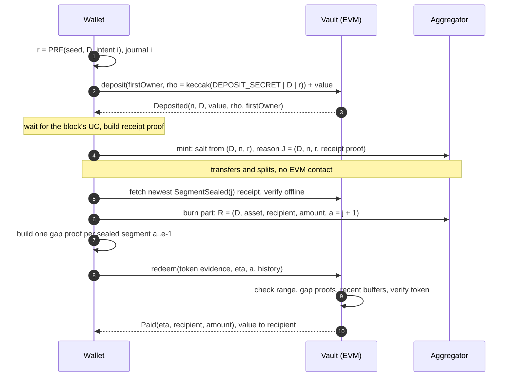
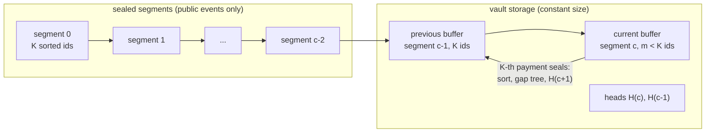
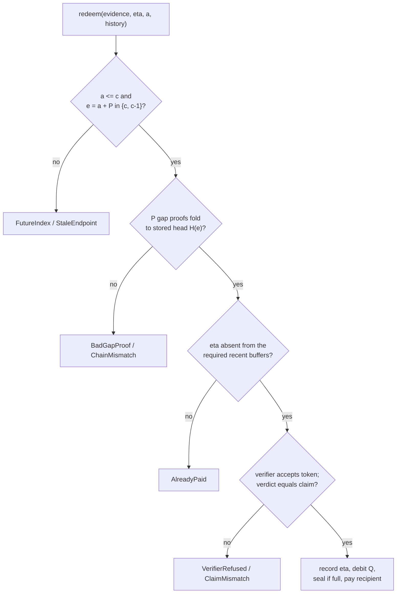

# Native bridge v2: indexed burns and bucketed redemption segments

Status: **frozen specification, development profile, not activated** (NB2-01, #1097; tracking #1096). It replaces the
protocol 6/7 bridge (lock records, per-lock accounting, `0x0104`/`0x0105` kernels) for all new work. There is no
migration from, compatibility with or dual decoding of protocol 6/7; NB2-10 (#1106) removes it.

Everything below is fixed byte for byte, except the few values marked

> **PARAM** *name*: candidates, default. **Fixed by #1098.**

which the gas bake-off (NB2-02, #1098) replaces with measured choices. A PARAM changes numbers and widths, never the
encodings around them. The companion byte contract for wallets is `protocol/interop.md` in native-bridge-plugins; it
carries the same bytes. If the two ever differ, this document is the reference and the difference is a bug.

Section 1 is the plain-language picture. Sections 3 to 13 are the rules. Section 14 lists every rejection rule by name.

## 1. How it works, in plain words

A user locks native UCT in one EVM contract, the **vault**, and receives the same amount as an ordinary Unicity token.
The token moves and splits off-chain like any other token. To get UCT back on the EVM, the holder burns a token part
and sends one EVM transaction that proves two things: the burn is genuine, and it has not been paid before.

**Deposit.** The wallet picks a secret `r` and sends `deposit(firstOwner, rho)` with the value, where `rho` is a hash
of `r`. The vault counts the deposit (number `n`), adds the value to its liability total and emits one `Deposited`
event. It stores nothing per deposit. The token ID is derived from `n` and `r`, so a chain observer who sees the event
cannot compute the token ID and cannot occupy it before the owner mints.

**Mint.** Once the deposit block is certified, the wallet makes an ordinary Unicity mint. Its reason carries `r` and a
receipt proof of the `Deposited` event. Anyone holding the token can later check, offline, that it is backed by a real
deposit into this vault.

**Circulation.** Transfers and splits are the SDK's, unchanged. Nothing touches the EVM.

**Burn.** The holder burns a whole part. The burn signs the EVM recipient, the amount and one number `a`: the lowest
redemption segment in which the vault may pay it. The wallet reads `a` from a verified `SegmentSealed` receipt, so it
can never be in the future.

**Redeem.** The vault keeps the identifiers of recent payments in two small buffers. Every K payments (default 64) the
current buffer is **sealed**: sorted, hashed into a Merkle tree of the gaps between consecutive identifiers, chained to
the previous segments and published in one `SegmentSealed` event. A redemption proves "not paid in sealed segments
`a` to now" with one short gap proof per segment, built by the wallet from public events. The vault checks the two
recent buffers itself, verifies the token, pays the signed recipient and records the identifier.

The vault's state never grows: one accounting word, two tag words, two chain heads and two buffers of K identifiers.







Checks before the token verifier are only a cheap filter. Nothing is granted until the verifier's verdict equals the
claimed identifier and index (Section 10).

## 2. Scope and known limits

First release: native UCT only, one asset per vault. Whole split parts return independently in any order; a partial
return needs an ordinary split first. Fixed signed recipient. Direct wallet submissions only.

Not in this release: ERC20, joins, destination redirection, continuation for oversized claims (NB2-12, #1108),
helper/indexer services, new ureth state, hooks or consensus rules, bridge-specific precompiles (`0x0105` is not
used), time-anchored burns.

Limits that stay visible:

- **Mint admission (#1039).** The hidden token ID stops at-leisure blocking from chain observation. An observer of the
  mint request or a hostile aggregator can still race it. Not fixed here.
- **Capacity.** A claim that waits through too much traffic may not fit one transaction (Section 12.5). There is no
  recovery path in this release.
- **Pooled custody.** There is no per-deposit backstop. A verifier bug that accepts a forged lineage can pay out other
  depositors' backing. NB2-03 (#1099) and NB2-05 (#1101) carry the independent-implementation requirement.
- **Recipient.** An immutable recipient that always reverts strands its burn. Wallets default to a controlled EOA.

## 3. Notation and primitives

- `C(x, ...)` is canonical CBOR of an array: definite lengths, shortest heads, exact arity, complete consumption. Maps,
  floats, simple values other than `null`, text strings and indefinite items are rejected in every structure defined
  here. `b(x)` is a byte string, `tag(t, x)` a tagged item. Domain literals are ASCII byte strings.
- `H_U` is SHA-256 (the Unicity hash). `H_E` is EVM `keccak256`. They are distinct functions and never substituted.
- `||` is byte concatenation. `u8`, `u16`, `u64` are fixed-width big-endian integers. `u256(x)` is the 32-byte
  big-endian word. Identifiers compare as unsigned 256-bit big-endian integers.
- **Amount** in CBOR is a minimal positive unsigned big-endian byte string of 1 to 32 bytes (no leading zero). In the EVM
  ABI it is `uint256`.
- **EVM domain tags** are bytes32 constants `TAG(name) = H_E(ASCII(name))`:

| Name | Value |
|---|---|
| `DEPOSIT_SECRET` = `TAG("UNICITY_NB2_DEPOSIT_SECRET")` | `0xdfa87a7a4c6db3c7c307e4f2c3cc2d4a07e33d349f542b47f8e0bba49f62e645` |
| `ARCHIVE_GENESIS` = `TAG("UNICITY_NB2_ARCHIVE_GENESIS")` | `0x45076af3d8858f1d7a9bb6e037bb5ca4270d0b4fa90f9397eb7adb905590a339` |
| `ARCHIVE_STEP` = `TAG("UNICITY_NB2_ARCHIVE_STEP")` | `0xc68efdc45f5c9a20bf6abfda6493e8e295d8e31495fd1e744cd4c35f74785dfa` |

- The Merkle tags are the single bytes `0x00` (leaf) and `0x01` (node).
- **CBOR tags.** New: `39051` NativeReceiptBacking (mint reason `J`), `39052` NativeSegmentReturn (return data `R`).
  Unchanged SDK tags: `39032` predicate, `39041` mint, `39045` transfer, `39031` certification data, `39040` token,
  `39033` inclusion proof, `39050` value, `39044` split justification, `39046` split manifest. The protocol 6/7 tags
  `39048` and `39049` are rejected wherever a v2 structure is expected.
- `NATIVE_BRIDGE_PROTO_VERSION = 8`. Every structure below that carries a version carries `1`.

## 4. Configuration and domain

### 4.1 The configuration tuple Γ

```
Γ = C(b("UNICITY_NB2_CFG"), 1,
      network,                  // α: uint, 1..65535 (SDK NetworkId)
      b(rootGenesis32),         // g_root
      b(executionGenesis32),    // g_evm
      chainId,                  // uint64, nonzero
      evmPartition,             // β_evm: uint32, nonzero
      b(evmShard),              // canonical native shard ID of the EVM shard, 1..33 bytes
      aggregatorPartition,      // β_agg: uint32, nonzero, != evmPartition
      b(vault20),               // a_V
      b(asset32),               // a_UCT, Section 4.2
      b(ty32), b(aid32),        // token type and coin ID, Section 4.2
      b(semanticProfileHash32), // SHA-256 of the canonical profile JSON (plug-ins protocol/profile.json)
      b(verifier20),            // token verifier address
      b(verifierCodeHash32),    // EXTCODEHASH of the verifier
      K,                        // uint, PARAM
      B,                        // uint, PARAM
      b(Qmax))                  // Amount, 1 <= Qmax <= 2^144 - 1 (Section 9.1)
D = H_U(Γ)
```

Arity 19. Every listed width is exact. `K` is a power of two with `2 <= K <= 256` and `B` a power of two with
`2 <= B <= K`; the vault and verifier reject `(K, B)` outside the deployed candidate set below. `D` is the deployment
domain: a reset or a new vault has a new `D`, even on a reused chain ID.

> **PARAM** `K`: {32, 64, 128}, default 64. `B`: {8, 16, 32}, default 16. **Fixed by #1098.**

The vault constructor receives the exact bytes of Γ, rejects them unless `vault20 == address(this)`,
`chainId == block.chainid`, `verifier20.codehash == verifierCodeHash32`, and `K`, `B`, `Qmax` are admitted, and then
fixes `D` as an immutable. Γ's bytes stay readable through `config()`. The verifier is stateless and configuration
free: it receives Γ on every call (Section 11), which avoids a cycle between its code hash and Γ.

### 4.2 Asset identity

```
Dstr = networkDecimal ":" rootGenesisHex ":" executionGenesisHex ":" chainIdDecimal
ty   = H_U(UTF8("unicity-bridge:unicity-native-nb2:" + Dstr))
aid  = H_U(UTF8("unicity-bridge-coin:unicity-native-nb2:" + Dstr))
a_UCT = H_U(UTF8("unicity-nb2-asset:native-uct"))
```

Decimals have no leading zeros, hex is lowercase without `0x`. `ty` and `aid` exclude the vault: a replacement v2 vault
on the same chain issues the same coin, but every token stays bound to its own vault through `D` in its mint reason.
The `-nb2` family string keeps v2 tokens apart from protocol 6/7 tokens.

### 4.3 Deployment manifest pins (not in D)

The authenticated deployment manifest (schema written by NB2-09, #1105) pins, outside `D`:

- `vaultRuntimeCodeHash`: the vault's runtime code hash. It is not in Γ, because the vault's immutables contain `D`.
  Wallets check it once at installation against certified EVM state.
- `maxEncodedTxBytes` (`L_max`): the effective encoded-transaction limit of the deployment's pool and RPC path.
- `userGasLimit`: the block gas available to user transactions (`max_gas - system_gas` of the production profile).
- `gasReserve` and `returnReserveSegments`: Section 12.
- `deploymentBlock`: the vault's creation block, where segment scanning starts.
- `stateReadOnly`: `true` only on test deployments, where a plain `state()` read may replace the receipt rule of 12.2.

> **PARAM** `L_max`: {131072, 524288}, default **524288 (512 KiB)**, pending the owner decision of Section 15 and the
> pool/RPC/peer measurement of NB2-09 (#1105).

The vault is immutable: no owner, upgrade, pause, administrative payout, `receive` or `fallback`. It emits no event
except the three of Section 13.2.

## 5. Deposit

### 5.1 Wallet secret

Before submitting value the wallet derives and journals

```
r   = HMAC-SHA256(key = k_w, msg = C(b("UNICITY_NB2_DEPOSIT_INTENT"), b(D), i))
rho = H_E(DEPOSIT_SECRET || D || r)             // 96 bytes hashed
```

`k_w` is a 32-byte wallet bridge key derived by the wallet from its seed (the derivation is the wallet's own, but must
be deterministic and backed up with the seed). `i` is a uint64 intent counter that is never reused; the wallet journals
`(D, i)` durably before signing the deposit transaction. Never derive `r` from an address or a small enumerable value.

Recovery from seed alone: for each `i` from 0 up to the journal high-water mark plus 64, recompute `rho` and look for a
`Deposited` event with that `rho`. Reusing an `r` across deposits is prohibited (it reveals the link), but cannot
mint the same root ID twice, because `n` differs.

### 5.2 `deposit`

```solidity
function deposit(bytes calldata firstOwner, bytes32 rho) external payable;
```

Under the shared reentrancy guard, in this order:

1. `msg.value > 0`, else `ZeroValue()`.
2. `firstOwner` is exactly the 42-byte tagged signature predicate
   `d9 9878 83 01 41 01 58 21 || key33` (`tag(39032, [1, b(0x01), b(key33)])`) with `key33[0] in {0x02, 0x03}`, else
   `BadFirstOwner()`. The vault does not check that the key is on the curve; an invalid key strands its own deposit,
   and the verifier rejects it.
3. `msg.value <= Qmax - Q`, else `LiabilityCap(Q, msg.value, Qmax)`.
4. `n < 2^56 - 1`, else `DepositCounterExhausted()`.
5. `n <- n + 1`, `Q <- Q + msg.value` in the accounting word (Section 9.1), with masked field updates.
6. Emit `Deposited(n, D, msg.value, rho, firstOwner)`.

Deposit numbers start at 1. There is no refund, cancellation or per-deposit storage. Unsolicited value (for example
from `SELFDESTRUCT`) is surplus and never increases `Q`; `balance(vault) >= Q` holds under correct execution.

### 5.3 Salt and token ID

```
salt_n = H_U(C(b("UNICITY_NB2_DEPOSIT_SALT"), b(D), n, b(r)))
id_n   = H_U(C(b(salt_n), network))             // the SDK token ID rule, unchanged
```

The vault never computes `salt_n` or `id_n`.

## 6. Mint reason and deposit proof

### 6.1 Encoding

```
J = tag(39051, [1, b(D), n, b(r), DepositProof])
DepositProof = [1, b(evmPDR), b(evmUC), b(headerRLP), txIndex, logIndex, [b(receiptNodeRLP), ...]]
```

`J` has body arity 5 and `DepositProof` arity 7; `DepositProof` is inline, not byte-string wrapped. `n`, `txIndex`
and `logIndex` are uints (`n` in `[1, 2^56-1]`, indices below `2^32`). `evmPDR` and `evmUC` are complete canonical
native encodings (PartitionDescriptionRecord, UnicityCertificate). The receipt is not carried separately: it is the
value of the final node of the receipt-trie path. The same `DepositProof` container, with the `SegmentSealed` event,
is the **seal receipt proof** of Section 12.2.

The root mint is the SDK mint `M = tag(39041, [2, network, P0, b(salt_n), b(ty), b(J), b(data), e])` with
`P0 = firstOwner`, `data = tag(39050, [1, [[b(aid), b(v)]], null])` and `e` null or a uint64 deadline (SDK rule).

### 6.2 Verification (wallet, recipient and on-chain verifier alike)

Decode strictly and bound before any cryptography (bounds in the profile JSON: `justificationBytes` 65536,
`ucBytes` 16384, `pdrBytes` 16384, `headerBytes` 2048, `receiptNodes` 65, `receiptBranchNodeBytes` 1024,
`receiptLeafNodeBytes` 49152). Then, in order:

1. `J.D == D` (`MintDomain`).
2. Verify `evmUC` under the historical authority of its seal epoch (Section 11.3), for partition `evmPartition` and
   shard `evmShard` (`DepositUC`). `H_U(evmPDR)` equals the UC's shard configuration hash and the PDR epoch equals the
   input record epoch (`DepositPDR`).
3. `H_E(headerRLP) == UC.InputRecord.blockHash` and `header.stateRoot == UC.InputRecord.hash`, pinned header encoding
   (`DepositHeader`). This is the certificate of the block that **executed** the deposit, not of its parent.
4. Verify the path under `header.receiptsRoot` with key `RLP(txIndex)`: canonical nodes, hash or embedded references,
   complete key consumption, no unused or duplicate node (`ReceiptPath`). The leaf value is a legacy receipt
   `RLP([status, cumulativeGas, bloom, logs])` or `type || RLP(...)` with `type in {0x01, 0x02, 0x03}`; anything else
   is `ReceiptType`. `status == 1` (`ReceiptStatus`).
5. `logs[logIndex]` exists (`LogIndex`), its address equals `vault20` (`LogEmitter`), and its topics are exactly
   `[topic0(Deposited), u256(n)]` (`LogTopics`).
6. Its data is exactly the 224-byte ABI encoding of `(bytes32 D, uint256 v, bytes32 rho, bytes firstOwner)` with
   offset `0x80`, length 42 and zero padding (`LogData`); `D` equals `J.D` and `v > 0`.
7. `rho == H_E(DEPOSIT_SECRET || D || r)` (`SecretOpening`).
8. The mint's salt is `salt_n` (`MintSalt`), its type `ty` (`MintType`), its first owner exactly `firstOwner`
   (`MintOwner`), its data the value envelope of exactly `aid` and `v` (`MintData`).

The vault address and the immutable deployment are authenticated by `D` (which binds `vault20` and `chainId`) and by
the manifest's runtime code hash; Cancun forbids redeploying different code at an address, so no per-receipt code
proof is carried. An RPC log listing or a transaction inclusion proof alone is never deposit evidence.

## 7. Circulation and split lineage

Token, predicate, transfer, certification and inclusion-proof wire formats are the SDK's, unchanged (`protocol/interop.md`
"SDK wire" lists them byte for byte, with the strict unlock-recovery, time and refresh rules of protocol 7, which carry
over unchanged). Owners are signature predicates; the first burn is terminal. For reading this document:

```
P     = tag(39032, [1, b(encode_uint(type)), b(params)])    // type 1: signature, params key33; type 2: burn, params H_U(R)
M     = tag(39041, [2, network, P0, b(salt32), b(ty32), b(J), b(data), e])
T     = tag(39045, [2, Pnext, b(mask32), dataOrNull, e])
CD    = tag(39031, [2, Psource, b(sourceHash32), b(txHash32), e, b(unlock65)])
Token = tag(39040, [2, [M, proof0], [[T1, proof1], ...]])
proof = tag(39033, [1, CD, t, b(bitmap32 || siblings32...), UC])
txHash = H_U(exact tagged M or T bytes)        sid = H_U(C(Psource, b(sourceHash32)))
```

Each transaction is certified by the aggregator through its inclusion proof, whose UC is judged under Section 11.3.
Intermediate transfers carry null data; a token ends either in its split-manifest burn or, for the returned part, in
the return burn of Section 8.

Splits use the SDK's burn-and-mint `TokenSplit` with the protocol 6 lineage formats, unchanged: manifest
`tag(39046, [b(root32)])`, allocation tree leaves `H_U(0x10 || key32 || data32 || u256(v))`, nodes
`H_U(0x11 || u8(depth) || hL || u256(sL) || hR || u256(sR))`, child commitment
`H_U(C(b("UNICITY_SPLIT_OUTPUT"), b(parentId), network, b(P), b(salt), b(childId), b(ty), b(exactChildMintData)))` and
`SplitJ = tag(39044, [ParentToken, [Proof]])`. The verifier walks from the returned part to the root while the mint
reason is `SplitJ`; the root's reason must be `J` (Section 6). One state-ID set covers the whole lineage. Every
non-returned token in the walk ends in its manifest burn; each edge's allocation proof verifies against the parent's
manifest root and the sum equals the parent's amount. Rule names are the protocol 6 ones (Section 14.4).

What changes from protocol 6: there is no per-lock accounting. Each part is redeemed by its own redemption ID
(Section 8.2); conservation follows from the lineage relation (Section 16).

## 8. Return burn and redemption identifier

### 8.1 Return data

```
R = tag(39052, [1, b(D), b(asset32), b(recipient20), b(v), a])
```

Body arity 6. `a` is a uint in `[0, 2^48 - 1]`, the minimum segment index at which the burn may be paid. The final
transfer of the returned part has predicate `Burn(H_U(R))` (type 2, params the raw 32-byte hash) and data exactly `R`.
`v` is the returned part's own amount. `recipient20` is nonzero and not `vault20`. There is no archive hash, fee,
deadline or redirection field.

### 8.2 Redemption identifier

```
btid = H_U(C(b("UNICITY_NB2_BURN"), b(sidBurn), b(txHashBurn)))
eta  = H_U(C(b("UNICITY_NB2_REDEMPTION"), b(D), b(btid)))
```

`sidBurn` is the SDK state ID of the burn transfer's source state and `txHashBurn` the SDK hash of the exact tagged
burn transfer. Refreshed inclusion paths, other certificates, proof encodings and submitters never change `eta`; `a`
is inside `txHashBurn` and so is immutable too. `bucket(eta) = eta >> (256 - log2 B)`.

## 9. Vault state

### 9.1 Logical state and the accounting word

```
Σ = (A, T_0, T_1, H_c, H_{c-1}, S_0, S_1)
A = n << 200 | c << 152 | m << 144 | Q          // n: 56 bits, c: 48, m: 8, Q: 144
```

`n` is the last deposit number, `c` the current segment index, `m` the current buffer's population (`0 <= m < K`) and
`Q` the outstanding liability. Field updates are masked and range-checked; a carry or borrow never reaches a
neighbouring field. `c` never exceeds `2^48 - 1` (`SegmentCounterExhausted()`), `n` never exceeds `2^56 - 1`.

`p = c mod 2` names the current buffer, `1 - p` the previous one. `H_c` is the current archive head, `H_{c-1}` the
previous one (invalid at `c = 0`). At construction `A = 0`, `H_0` is set (Section 10.3) and nothing else is written.

### 9.2 Recent buffers: position tags (baseline)

`S_p[i]` for `0 <= i < K` is the `i`-th identifier paid into buffer `p` in arrival order. The tag words `T_p` hold one
`log2 B`-bit tag per position: `tag_p(i) = bucket(S_p[i])`. With `t = floor(256 / log2 B)` tags per word, tag `i` is in
word `floor(i / t)` at bit offset `log2 B * (i mod t)` (least significant first).

| K \ B | 8 | 16 | 32 |
|---|---:|---:|---:|
| 32 | 1 word | 1 | 1 |
| 64 | 1 | 1 | 2 |
| 128 | 2 | 2 | 3 |

The live entries of buffer `p` are positions `i < pop(p)`, with `pop(current) = m` and `pop(previous) = K` when
`c > 0`. Cells and tags at or beyond the population are stale and ignored; nothing is ever cleared. Identifier storage
is bounded by `2K` slots (128 at `K = 64`), plus `2 * words(K, B)` tag words.

> **PARAM** recent-buffer layout: {position tags (this section), v2 sparse per-bucket arrays with generation/count
> words}, default **position tags**. Storage slot numbering is not part of the wire contract: wallets use views,
> events and receipts only. **Fixed by #1098.** If #1098 selects the sparse layout, the accounting word reverts to
> `A = n << 192 | Q` (64/192 bits) with `c` in the metadata words, and `Qmax <= 2^192 - 1`.

## 10. Segments and the gap commitment

> **PARAM** segment commitment: {sorted circular-gap tree (this section), compressed radix, adjacent-leaf multiproof},
> default **circular-gap tree**. **Fixed by #1098.** The archive chain of 10.3 and the event of 13.2 do not depend on
> this choice; only `M_j` and the proof format of 10.2 do.

### 10.1 Sorted circular-gap tree

Sealed segment `j` contains exactly the `K` identifiers paid while `c = j`, sorted strictly increasing
`z_0 < z_1 < ... < z_{K-1}`. With `h = log2 K`:

```
leaf_i = H_E(0x00 || z_i || z_{(i+1) mod K})                 // 65 bytes hashed
node   = H_E(0x01 || left || right)                          // 65 bytes hashed, ordered children
M_j    = root of the complete binary tree over leaf_0 .. leaf_{K-1}
```

No padding, no sorted-pair hashing. The last leaf is the exterior gap that wraps around the numeric domain. Zero and
`2^256 - 1` are ordinary identifiers, not sentinels.

### 10.2 Gap proof

```
proof = u8(i) || l (32) || u (32) || s_0 (32) || ... || s_{h-1} (32)       // exactly 65 + 32h bytes
```

257 bytes at `K = 64`, 289 at `K = 128`. A proof is valid for `eta` against root `M` when `i < K` and

- `i < K - 1`: `l < u` and `l < eta < u`;
- `i = K - 1`: `l > u` and (`eta > l` or `eta < u`);

and folding `x = H_E(0x00 || l || u)` with `s_k` for `k = 0 .. h-1` gives `M`, where step `k` computes
`H_E(0x01 || x || s_k)` if bit `k` of `i` is 0 and `H_E(0x01 || s_k || x)` if it is 1. No root is sent; it is derived.

### 10.3 Archive chain

```
H_0     = H_E(ARCHIVE_GENESIS || D || u16(K))                              // 66 bytes hashed
H_{j+1} = H_E(ARCHIVE_STEP || D || u64(j) || H_j || M_j)                   // 136 bytes hashed
```

### 10.4 Sealing

When a payment makes `m = K`, in the same transaction and before the payout call:

1. Read `S_p[0 .. K-1]`, distribute by tag, sort within each bucket (insertion sort for short buckets, a bounded
   worst-case sort such as heapsort for long ones: one bucket can hold all `K`), and concatenate buckets in increasing
   order. Assert strict increase and that every identifier lies in its tagged bucket.
2. Compute `M_c` and `H_{c+1}`; emit `SegmentSealed(c, H_c, H_{c+1}, z_0 || ... || z_{K-1})`.
3. Set `H_{c-1} <- H_c`, `H_c <- H_{c+1}`, `c <- c + 1`, `m <- 0`. The full buffer becomes the previous one; the old
   previous buffer becomes current without clearing.

There is no empty, early, timed or public seal. Segment indices count payment groups, not blocks or time.

## 11. Redemption

### 11.1 `redeem`

```solidity
function redeem(bytes calldata evidence, bytes32 claimedEta, uint64 claimedStart, bytes calldata history) external;
```

- `evidence = C(1, Token)`: the complete returned part as one SDK token (`tag(39040, ...)`, inline), carrying every
  transaction with its inclusion proof and, through its mint reason, its lineage and deposit proof. Proof
  consolidation and refresh may replace inclusion paths and UCs under the SDK's rules; transaction bytes and reference
  times never change.
- `history` is empty when `P = 0`, and otherwise `startHead (32) || proof_0 || ... || proof_{P-1}` with each proof
  `65 + 32h` bytes, so `P = (len - 32) / (65 + 32h)`.

Order of checks, with the error each one raises:

1. Reentrancy guard (`Reentrancy()`). Length of `history` is 0 or `32 + P(65 + 32h)` with `P >= 1`, else
   `BadHistoryLength(len)`.
2. `a = claimedStart`, `e = a + P` (checked). `a <= c`, else `FutureIndex(a, c)`. `e == c`, or `c > 0` and
   `e == c - 1`, else `StaleEndpoint(e, c)`.
3. If `P > 0`: fold from `startHead` through `j = a .. e-1`, `x <- H_E(ARCHIVE_STEP || D || u64(j) || x || M_j)` with
   `M_j` derived from proof `j - a` for `claimedEta` (a malformed or non-gap proof is `BadGapProof(j - a)`), and
   require `x` equal to the stored `H_e` (`ChainMismatch()`).
4. Scan the current buffer, and also the previous buffer when `e == c - 1`: every live position whose tag equals
   `bucket(claimedEta)` must hold a different identifier, else `AlreadyPaid(claimedEta)`.
5. `STATICCALL` the verifier (Section 11.2) with `(config(), evidence)`. A revert is
   `VerifierRefused(revertData)`; return data other than exactly 192 canonical bytes is `VerifierBadReturn()`.
6. Verdict checks: `domain == D` (`DomainMismatch()`), `asset == a_UCT` (`AssetMismatch()`),
   `(eta, minSegment) == (claimedEta, claimedStart)` (`ClaimMismatch()`), `recipient` nonzero and not the vault
   (`BadRecipient()`), `amount > 0` (`ZeroAmount()`), `amount <= Q` (`LiabilityUnderflow(Q, amount)`).
7. Effects: `S_p[m] <- eta`, `tag_p(m) <- bucket(eta)`, `m <- m + 1`, `Q <- Q - amount`; emit
   `Paid(eta, recipient, amount)`; if `m == K` seal (Section 10.4).
8. Pay exactly `amount` to `recipient` with a plain value call forwarding the remaining gas; failure is
   `PayoutFailed()` and reverts everything, including the seal and the logs.

Steps 1 to 4 grant nothing. A forged `claimedEta` that passes them fails step 6. Clients reserve full verification gas
for every first claim; the cheap rejections are a convenience, not a bound for inputs built to evade them.

### 11.2 Verifier interface

```solidity
interface INativeBridgeVerifierV2 {
    function verifyReturn(bytes calldata gamma, bytes calldata evidence)
        external view
        returns (bytes32 domain, bytes32 eta, uint64 minSegment, bytes32 asset, address recipient, uint256 amount);
}
```

Selector `0xdf447dca`. The verifier is stateless, has no owner or configuration of its own, and reverts on every
refusal with a custom error named by Section 14 (`<RuleName>()`, selector `H_E("<RuleName>()")[0..4]`). On acceptance
it returns the authenticated `(D, eta, a, asset, recipient, v)` of the returned part. It must:

1. Decode Γ strictly (`ConfigShape`) and compute `D`.
2. Decode `evidence` strictly (`EvidenceShape`) and the token under the SDK wire rules.
3. Walk the lineage to the root (Section 7) and verify the root's `J` (Section 6.2).
4. Verify every mint, transfer, certification datum, unlock signature and inclusion proof of every token in the walk,
   each inclusion proof's UC under Section 11.3, for partition `aggregatorPartition`.
5. Require the returned part's final transfer to be the burn of Section 8.1 with data `R`; `R.D == D`, `R.v` equal to
   the part's own amount, recipient valid (`ReturnData`, `ReturnDomain`, `ReturnAmount`, `ReturnRecipient`).
6. Compute `btid` and `eta` (Section 8.2) and return.

The vault and the verifier are separate deliverables behind this interface (NB2-04, #1100, and NB2-05, #1101). The
internal division of the verifier into Solidity and existing generic primitives (`0x0100` certificate batch, `0x0102`
membership) is NB2-05's decision gate and changes no byte above.

### 11.3 Historical authority

Every UC (the deposit's EVM UC and every aggregator UC) is judged under the Unicity Trust Base entry of its own seal
epoch, by the upstream seal rule, as in protocol 7 (`protocol/trust-base.md` in native-bridge-plugins): weights and
threshold `floor(2W/3) + 1` of that entry, root round inside the epoch's interval, an unknown signer or a non-canonical
signature counts zero. Wallets hold the history and retry `NoEntryForEpoch`. On chain the verifier reads the same
history from the chain's permanent seal registry through the generic certificate primitive, at any certificate age.
A later rotation never invalidates an earlier certificate.

## 12. Wallet rules that affect safety

### 12.1 Before depositing

Journal `(D, i)` and back up `k_w` (Section 5.1). Check the deployment (Γ, `D`, manifest pins, runtime code hash) and
the first owner. Submit `deposit`. Keep the deposit transaction hash; build `J` after the block is certified.

### 12.2 Choosing the burn index (review amendment R1)

Before burning, the wallet obtains the newest `SegmentSealed(j)` receipt it can, as a `DepositProof` container whose
log is `SegmentSealed` (topics `[topic0(SegmentSealed), u256(j)]`, data per Section 13.2) from `vault20`, and verifies
it offline exactly as Section 6.2 steps 2 to 5. It signs `a = j + 1` and keeps `headAfter = H_{j+1}` as the starting
head for a later redemption. If it holds no seal receipt, it signs `a = 0` (starting head `H_0`, computed).

- The index can never be in the future: `c` never decreases and the receipt proves `c >= j + 1`.
- A provider that hides newer seals only makes the wallet anchor lower and pay more gap proofs.
- A plain `state()` read replaces the receipt only when the manifest's `stateReadOnly` is true (test deployments).

### 12.3 Building the history at redemption

Fetch one `SegmentSealed` log per segment `a .. c-1` from any RPC or archive. For each, check the length (`32K`
bytes), strict order, recompute `M_j` and check `H_{j+1} = H_E(ARCHIVE_STEP || D || u64(j) || headBefore || M_j)` and
`headAfter` equal to it. If `eta` is in a segment, it has been paid (reconcile with `Paid`). Otherwise build its gap
proof. Choose `e = c` (or `e = c - 1` when the chain moves while preparing); one rollover between preparation and
inclusion is tolerated, two make the endpoint stale and the wallet rebuilds the history without changing the burn.

### 12.4 Gas-limit reserve

Every redemption's gas limit is the expected cost plus `gasReserve`, the worst sealing surcharge plus the worst recent
scan (`2K - 1` cold identifier reads), because intervening payments can make any transaction the sealing one.

> **PARAM** `gasReserve`: planning value **620,000** at `K = 64, B = 16` (sealing 180,000 to 350,000 plus a
> 266,700-gas worst scan). **Fixed by #1098** from the measured concentrated-bucket worst case.

### 12.5 Size preflight

With `L_T` the encoded evidence, `L_O` all other transaction framing (including the 32-byte start head when `P > 0`)
and `P_max = floor((L_max - L_T - L_O) / (65 + 32h))`:

- Before burning, refuse (`CapacityPreflight`) unless `P_max >= returnReserveSegments`, a manifest value
  (**default 64 segments**, 4,096 payments at `K = 64`) that covers the return delay the wallet declares.
- At redemption, refuse to submit (`CapacityExceeded`) if `P > P_max` or the gas exceeds `userGasLimit`. In this
  release that burn cannot be redeemed until limits change; it is not recoverable by the wallet.

### 12.6 Burn, submission and retry

Verify the token's full provenance before burning. Construct, persist and certify the terminal burn; durably keep the
exact certified result before reporting success. After a timeout or an ambiguous submission, look for `Paid(eta)`
before retrying; refresh stale history; never alter the certified burn or its index.

## 13. Vault ABI

### 13.1 Functions

| Function | Selector |
|---|---|
| `deposit(bytes firstOwner, bytes32 rho) payable` | `0x3489c151` |
| `redeem(bytes evidence, bytes32 claimedEta, uint64 claimedStart, bytes history)` | `0x91de2955` |
| `domain() view returns (bytes32)` | `0xc2fb26a6` |
| `config() view returns (bytes)` (exact Γ) | `0x79502c55` |
| `state() view returns (uint64 deposits, uint64 segment, uint16 population, uint256 outstanding, bytes32 head, bytes32 previousHead)` | `0xc19d93fb` |

`previousHead` is zero at `c = 0`. The constructor is `constructor(bytes gamma)` (Section 4.1).

### 13.2 Events

| Event | topic0 |
|---|---|
| `Deposited(uint64 indexed nonce, bytes32 domain, uint256 amount, bytes32 rho, bytes firstOwner)` | `0x853a9d825910065273b44cf4f0ad33d2525f875d3da0a53f967ae40b7508d2b8` |
| `Paid(bytes32 indexed eta, address indexed recipient, uint256 amount)` | `0x606160394df2742a67735645b7e783304d61d2dbc5b550e8c6acfaf27b6291d7` |
| `SegmentSealed(uint64 indexed segment, bytes32 headBefore, bytes32 headAfter, bytes ids)` | `0x06e724201a1c72937156cbdb3b9522d26b3818ee33ace10cd7cda65bb9cae916` |

Data layouts (standard ABI, exact lengths): `Deposited` 224 bytes (`domain`, `amount`, `rho`, offset `0x80`, length 42,
42 bytes padded to 64); `Paid` 32 bytes (`amount`); `SegmentSealed` `128 + 32K` bytes (`headBefore`, `headAfter`,
offset `0x60`, length `32K`, the sorted identifiers). Logs of failed transactions never count.

### 13.3 Custom errors

| Error | Selector | Raised by |
|---|---|---|
| `ZeroValue()` | `0x7c946ed7` | deposit 1 |
| `BadFirstOwner()` | `0xceb54b37` | deposit 2 |
| `LiabilityCap(uint256 outstanding, uint256 amount, uint256 cap)` | `0x5586a2e8` | deposit 3 |
| `DepositCounterExhausted()` | `0xb6ef324c` | deposit 4 |
| `Reentrancy()` | `0xab143c06` | deposit, redeem |
| `BadHistoryLength(uint256 length)` | `0x37c8cb02` | redeem 1 |
| `FutureIndex(uint64 start, uint64 current)` | `0x39a15193` | redeem 2 |
| `StaleEndpoint(uint64 endpoint, uint64 current)` | `0x683c7c78` | redeem 2 |
| `BadGapProof(uint256 position)` | `0xe7169745` | redeem 3 |
| `ChainMismatch()` | `0xa6226dc5` | redeem 3 |
| `AlreadyPaid(bytes32 eta)` | `0xf4b76a0e` | redeem 4 |
| `VerifierRefused(bytes reason)` | `0x3aa84d02` | redeem 5 |
| `VerifierBadReturn()` | `0xf659e897` | redeem 5 |
| `DomainMismatch()` | `0xce548c1e` | redeem 6 |
| `AssetMismatch()` | `0x83c1010a` | redeem 6 |
| `ClaimMismatch()` | `0x827768e8` | redeem 6 |
| `BadRecipient()` | `0x67a2cc26` | redeem 6 |
| `ZeroAmount()` | `0x1f2a2005` | redeem 6 |
| `LiabilityUnderflow(uint256 outstanding, uint256 amount)` | `0xf9c1fdc7` | redeem 6 |
| `SegmentCounterExhausted()` | `0x011469c0` | redeem 7 (seal) |
| `PayoutFailed()` | `0x3b1ab104` | redeem 8 |
| `BadConfig(uint256 field)` | `0x0dad7c22` | constructor (field index in Γ) |

A wallet classifies a failed simulation by selector: `AlreadyPaid` means reconcile; `StaleEndpoint` means rebuild the
history; `FutureIndex` means wait (it cannot arise from Section 12.2); `BadGapProof`/`ChainMismatch` means a wrong
proof or start head, repairable without a new burn; `VerifierRefused` carries the verifier's rule.

## 14. Rejection rules

Every rule has one name. NB2-03 (#1099) uses `Err<Name>` as the Go sentinel; the on-chain verifier reverts with
`<Name>()`; the vault's names and selectors are those of Section 13.3. Each rule gets one isolated negative vector.

### 14.1 Encoding (all structures)

| Name | Rule |
|---|---|
| `Truncated`, `Trailing` | input ends early, or bytes remain after the item |
| `NonCanonical` | non-shortest head, indefinite length, or a forbidden CBOR item |
| `Shape` | wrong arity, item type or literal domain string |
| `Tag` | unexpected tag, including protocol 6/7 tags 39048/39049 |
| `Version` | a version field other than 1 (SDK structures: their own versions) |
| `Length` | a fixed-width field of the wrong length |
| `IntRange` | an integer outside its range (network, chain, partition, `n`, `a`, indices, `K`, `B`, `Qmax`) |
| `InputTooLarge` | a component over its profile bound |
| `ConfigShape` | Γ fails any of the above or a Section 4.1 constraint |
| `EvidenceShape` | `evidence` is not exactly `C(1, Token)` |

### 14.2 Deposit evidence (Section 6.2)

`MintDomain`, `DepositUC`, `DepositPDR`, `DepositHeader`, `ReceiptPath`, `ReceiptType`, `ReceiptStatus`, `LogIndex`,
`LogEmitter`, `LogTopics`, `LogData`, `SecretOpening`, `MintSalt`, `MintType`, `MintOwner`, `MintData`, and
`MintReason` (the root mint's reason is not `tag(39051, ...)`).

### 14.3 Return (Sections 8 and 11.2)

| Name | Rule |
|---|---|
| `NotBurn` | the part's final transfer does not lock a burn predicate |
| `BurnNotFinal` | a burn predicate before the final transfer |
| `BurnReason` | burn params are not `H_U(R)` |
| `ReturnData` | the final transfer's data is not exactly a `tag(39052, ...)` `R` |
| `ReturnDomain` | `R.D != D` |
| `ReturnAsset` | `R.asset != a_UCT` |
| `ReturnAmount` | `R.v` is not the part's own amount |
| `ReturnRecipient` | recipient zero or the vault |
| `ReturnIndex` | `a` outside `[0, 2^48 - 1]` |

### 14.4 Token and lineage (unchanged from protocol 7)

`Predicate`, `MintShape`, `TransferData`, `CDMismatch`, `Unlock`, `UnlockLength`, `UnlockScalars`, `UnlockRecovery`,
`UnlockKey`, `MinterKey`, `RepeatedSID`, `NoTransfers`, `DeadlineMismatch`, `DeadlineExpired`, `InclusionProof`,
`ReferenceTime`, `SealNetwork`, `SealEpoch`, `NoEntryForEpoch` (retryable), `CertStructure`, `SealRoot`,
`QuorumNotMet`, `UnsupportedCertificateEncoding`, `SplitJustif`, `SplitProofCount`, `SplitProofShape`,
`SplitManifest`, `SplitBurn`, `SplitProof`, `SplitSum`.

### 14.5 Redemption (vault)

`BadHistoryLength`, `FutureIndex`, `StaleEndpoint`, `BadGapProof`, `ChainMismatch`, `AlreadyPaid`, `VerifierRefused`,
`VerifierBadReturn`, `DomainMismatch`, `AssetMismatch`, `ClaimMismatch`, `BadRecipient`, `ZeroAmount`,
`LiabilityUnderflow`, `SegmentCounterExhausted`, `PayoutFailed`, `Reentrancy`. Deposit: `ZeroValue`,
`BadFirstOwner`, `LiabilityCap`, `DepositCounterExhausted`. Construction: `BadConfig`.

### 14.6 Wallet refusals (no on-chain counterpart)

`SealReceipt` (a seal receipt fails Section 6.2 steps 2 to 5 for `SegmentSealed`), `SegmentLog` (a `SegmentSealed`
log has the wrong length, order or chain link), `CapacityPreflight`, `CapacityExceeded`, `ImplausibleIndex` (a
`stateReadOnly` read jumps beyond the wallet's verified bound).

## 15. Parameters left for #1098, and open owner decisions

| Parameter | Candidates | Default here | Decided by |
|---|---|---|---|
| `K` | 32, 64, 128 | 64 | #1098 |
| `B` | 8, 16, 32 | 16 | #1098 |
| Recent-buffer layout | position tags; v2 sparse buckets; shared arena | position tags | #1098 |
| Segment commitment | circular-gap tree; compressed radix; adjacent-leaf multiproof | circular-gap tree | #1098 |
| `gasReserve` | measured worst seal + worst scan | 620,000 | #1098 |
| `L_max` (manifest) | 128 KiB, 512 KiB | 512 KiB | owner, measured by #1105 |
| `Qmax` (Γ) | `<= 2^144 - 1` | deployment choice | #1105 |
| `returnReserveSegments` (manifest) | any | 64 | #1105 |

Open owner decisions (recorded in `briefs/owner-questions.md` with these defaults):

1. **Continuation before real value.** Default: a real-value deployment requires NB2-12 (#1108) or an explicit owner
   acceptance of the capacity limit of Section 12.5; test deployments ship without it.
2. **Encoded-transaction limit.** Default: pin 512 KiB in the deployment's pool and RPC configuration, falling back to
   128 KiB if #1105 finds that RPC bodies or peer propagation cannot carry it. At `K = 64` with 20 KiB of evidence this
   is about 1,952 segments (124,928 intervening payments) against 422 at 128 KiB.
3. **No per-receipt code proof.** Default: the deposit proof carries no account proof of the vault's code; `D` and the
   manifest's runtime code hash authenticate the deployment (Section 6.2).

## 16. Safety argument

Invariants of every committed state: `H_c` commits to exactly the payments of sealed segments `0 .. c-1` with their
indices; every `M_j` was computed by the vault from its own `K` distinct sorted identifiers; live buffer positions are
exactly the payments of segments `c` (and `c - 1`); `Q` equals deposits minus payouts and `balance >= Q`; a reverted
call leaves no state or log.

**At most one payout per burn.** Fix a verified burn with immutable `(eta, a)`. Every payout of it happens at some
segment `j >= a`. A second attempt with endpoint `e` must cover `j`: if `j < e`, segment `j` is in the folded suffix
`a .. e-1` and has no gap containing `eta`; if `j >= e`, then `j` is `c` or `c - 1` and is in a scanned buffer, where
equality rejects. An unsigned wrong start head cannot reach the stored `H_e` without a hash collision, so it is only a
repairable error. The argument needs the final equality of step 6: early checks run on claimed values only.

**Conservation.** One deposit `(n, r)` determines one root ID, amount and owner; mint certification selects one genesis
for that ID; each split spends its parent once and allocates distinct positive child amounts that sum to the parent;
a parent cannot both split and return. So distinct returned parts cannot exceed their deposit, and at-most-once payout
stops any part being counted twice. This rests on the verifier: there is no per-deposit backstop.

## 17. Structural model

`docs/design/models/nb2_segments.py` is the model the design's validation record cites, recovered from the session
that produced it, extended with the position-tag layout (R2), the seal-receipt index rule (R1) and the packed
accounting word. Re-run:

```
python3 docs/design/models/nb2_segments.py
```

It needs only the Python standard library and finishes in a few seconds. It uses SHA-256 in place of `keccak256` and no
CBOR, so it is not a vector suite (NB2-03, #1099, produces those) and says nothing about gas.

## 18. Review amendments and where they landed

| Review item | Landed in |
|---|---|
| R1: authenticate the index with a `SegmentSealed` receipt | Section 12.2; the receipt container is `DepositProof` (6.1); wallet refusal `SealReceipt` (14.6); time-anchor alternative dropped (Section 19) |
| R2: position tags instead of per-bucket arrays | Sections 9.1 (accounting word with `c` and `m`) and 9.2 (tag words), baseline; v2 sparse layout kept as the #1098 comparison (PARAM in 9.2); model part 2 |
| R3: pin the transaction-size limit before deciding on continuation | `L_max` in the manifest (4.3), size preflight (12.5), owner decisions 1 and 2 (Section 15) |
| Note: the model is not saved | Section 17, `docs/design/models/nb2_segments.py` |
| Note: gas-limit reserve as a number | Section 12.4, `gasReserve` 620,000 (PARAM) |
| Note: check order of redeem step 3 | Section 11.1: historical proofs (step 3) before the recent scan (step 4); the order is frozen so errors classify deterministically |
| Corrections confirmed (30M test profile, encoded-length limit, `2K - 1` scan, high index can strand) | Sections 4.3 (`userGasLimit` from the production profile), 12.5, 12.4, 12.2 |

## 19. Deferred and dropped alternatives

Dropped: the signed time anchor (R1 makes it unnecessary), chronological tail hashes, calldata-prefix protocol, public
early sealing. Deferred: continuation (NB2-12, #1108; sender-keyed persistent progress is the simplest candidate and
needs a state-growth design), destination authorization, ERC20/multi-asset/joins, withdrawal throttle, union
hierarchies or MMRs over segments, issuance evidence outside the hashed mint.

## 20. Sources

- Design `briefs/native-bridge-checkpoint-segments-design-v2.md` and review `briefs/native-bridge-checkpoint-segments-review-v2.md`
  (agre workspace, 2026-11-15); this document supersedes both for implementation.
- Unchanged token and split wire: native-bridge-plugins `protocol/interop.md`; `docs/design/bridge-split-lineage-spec.md`.
- EVM certification and offline event proofs: `docs/pos/specification/evm-partition.tex`.
- Gas primitives: EIP-2028, EIP-2200, EIP-2929, EIP-1153 (Cancun). All gas figures here are planning values; #1098 measures.
